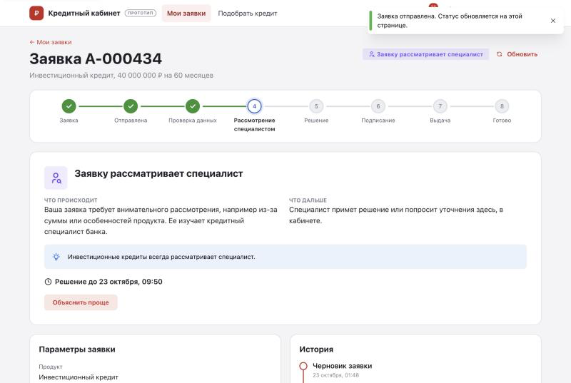
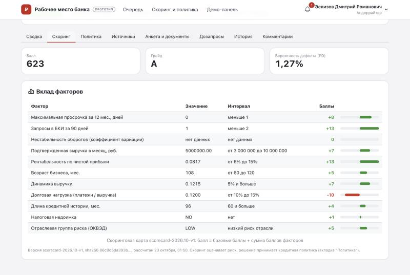
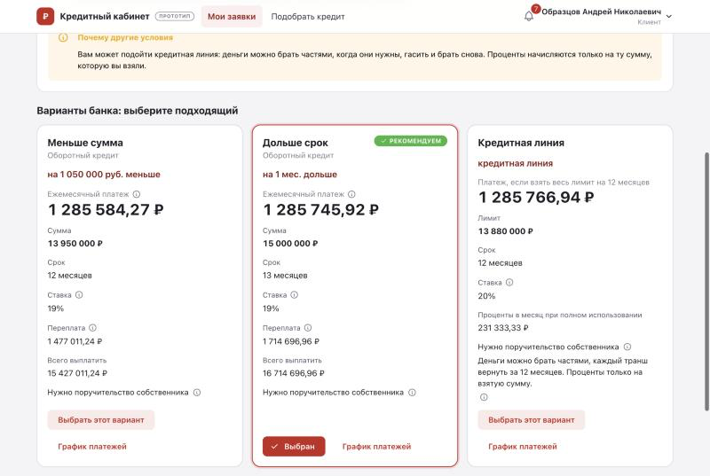
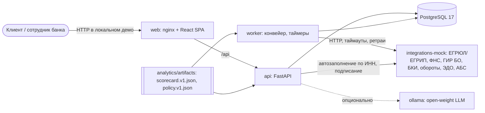

# Кредитный кабинет предпринимателя

Статус: демонстрационный MVP на синтетических данных. Реальные реестры, БКИ, ЭДО и АБС заменены симуляторами; документы ЭДО выдаются как UTF-8 `text/plain; charset=utf-8`. Подписание кодом и выдача смоделированы. [Статусы реализации и границы проверки](docs/product/implementation-status.md), [каноническая схема процесса](docs/process/application-states.md#4-диаграмма-состояний), [roadmap проверки ценности](docs/product/roadmap.md).

Прототип цифрового кредитного конвейера для малого и микробизнеса. Проект подготовлен для Alfa Hack 2026, кейс "Умный кредитный кабинет".

Предприниматель проходит весь путь в одном веб-продукте. Сначала он описывает задачу бизнеса и получает подходящий продукт. Затем подает заявку с автозаполнением по ИНН. Дальше он видит понятный статус с подсказкой "что дальше" и получает решение: одобрение, контрпредложение, дозапрос или отказ с объяснением. После этого подписывает документы и получает выдачу.

Банк в том же продукте управляет процессом: проверкой полноты, обогащением из внешних источников, скорингом, кредитной политикой и ручным рассмотрением у андеррайтера. Крупные суммы и переопределения подтверждает риск-менеджер по принципу 4 глаз. Метрики процесса доступны на отдельном экране.

| Клиент: статус заявки | Андеррайтер: карточка и скоринг | Клиент: варианты предложения |
|---|---|---|
|  |  |  |

Все скриншоты лежат в [docs/screenshots](docs/screenshots).

## Быстрый старт

Требования:
- Docker Engine 24+ или Docker Desktop с Compose v2;
- 4 ГБ свободной памяти;
- свободные порты 8080 и 8000;
- Python 3.9+ на хосте нужен только для e2e-скрипта.

Для базового демо интернет нужен при первой сборке образов. Опциональная модель загружается отдельно; Swagger UI использует внешний CDN (см. [THIRD_PARTY_NOTICES](THIRD_PARTY_NOTICES)).

```bash
git clone https://github.com/aqwckk/alpha-hack-lions.git && cd alpha-hack-lions
docker compose up --build -d --wait
```

Файл `.env` не нужен: значения для локальной демонстрации заданы по умолчанию. Первая сборка занимает несколько минут. Готовность стека проверяет `docker compose ps`: все сервисы должны быть в статусе `healthy`, а `migrate` должен завершиться с кодом 0.

| Что | Адрес |
|---|---|
| Веб-интерфейс (клиент и банк) | http://localhost:8080 |
| Swagger UI | http://localhost:8080/api/docs |
| API напрямую (для e2e и Postman) | http://localhost:8000/api |

Остановка: `docker compose down`. Полный сброс данных: `make reset`.

## Тестовые учетные записи

Все данные синтетические. Учетные записи показаны прямо на странице входа, пока включен `DEMO_MODE`.

| Роль | Логин | Пароль | Для чего |
|---|---|---|---|
| Клиент | `client.irina` | `Demo-Client-2026` | S1: ИП, экспресс-кредит, автоодобрение |
| Клиент | `client.andrey` | `Demo-Client-2026` | S2: ООО, оборотный кредит, контрпредложение |
| Клиент | `client.marina` | `Demo-Client-2026` | S3: ООО, инвестиционный кредит, дозапрос и ручное рассмотрение |
| Клиент | `client.sergey` | `Demo-Client-2026` | S4: отказ по стоп-факторам |
| Клиент | `client.oleg` | `Demo-Client-2026` | S5: сбой БКИ и автоматический ретрай |
| Клиент | `client.demo` | `Demo-Client-2026` | свободная проверка на дополнительных ИНН |
| Андеррайтер | `uw.dmitry`, `uw.anna` | `Demo-Uw-2026` | очередь ручного рассмотрения, решения |
| Риск-менеджер | `risk.elena` | `Demo-Risk-2026` | подтверждение по 4 глазам, метрики, версии конфигов, аудит, демо-панель |

## Сценарий проверки

Подробные шаги и ожидаемые результаты описаны в [docs/testing](docs/testing/README.md) и [docs/product/demo-scenarios.md](docs/product/demo-scenarios.md). Главный сценарий для показа S3:

1. Войти как `client.marina` и нажать "Подобрать кредит". Задача: "Купить оборудование или транспорт", 40 000 000 руб. на 60 месяцев. Продукт: инвестиционный кредит.
2. В мастере ввести ИНН `0010003018`. Сведения о компании подставятся из реестров. Затем заполнить параметры и финансы, приложить документы, дать согласия и отправить заявку.
3. Статус обновится сам: проверка, обогащение из ЕГРЮЛ, ФНС, ГИР БО и БКИ, скоринг, решение политики. Заявка уйдет специалисту, потому что продукт рассматривается только вручную и заявленная выручка расходится с отчетностью на 35%.
4. Выйти и войти как `uw.dmitry`, открыть "Очередь", нажать "Взять в работу". В карточке видны источники, баллы по факторам, путь правил политики и рекомендация. Нажать "Запросить данные".
5. Войти как `client.marina` и ответить на дозапрос. Заявка вернется тому же андеррайтеру.
6. `uw.dmitry` одобряет 40 000 000 руб. на 60 месяцев. Это выше рекомендации, поэтому интерфейс предупредит о переопределении и отправит решение на согласование.
7. `risk.elena` подтверждает решение во вкладке "На согласовании".
8. `client.marina` сравнивает условия, принимает предложение, подписывает документы кодом из интерфейса (SMS нет) и получает статус "Кредит выдан".

Остальные сценарии короче:
- **S1:** `client.irina`, ИНН `002000010193`, 1 200 000 руб. на 24 месяца. Автоодобрение за секунды.
- **S2:** `client.andrey`, ИНН `0010002014`, 15 000 000 руб. на 12 месяцев. Три варианта: меньше сумма, дольше срок, кредитная линия.
- **S4:** `client.sergey`, ИНН `002000040102`. Отказ с понятным объяснением.
- **S5:** `client.oleg`, ИНН `0010005015`. Перед запуском нажать "Сбросить сбои" на демо-панели `/bank/demo`.

Команда `make e2e` проверяет сценарии через API запущенного стека, в том числе через nginx. Это не полный браузерный e2e; UI и ручные проверки частичны. Результаты проверки исправлений: [audit-fixes.md](docs/testing/audit-fixes.md), общие сценарии: [docs/testing](docs/testing/README.md).

## Архитектура



- **web.** SPA на React и TypeScript, раздается nginx. Тот же nginx проксирует `/api`, поэтому интерфейс и API живут на одном origin.
- **api.** Сервис с состоянием в БД; архитектура допускает несколько реплик, нагрузка и горизонтальное масштабирование не верифицированы. Отвечает за аутентификацию (JWT и refresh-cookie), роли и проверку доступа к объекту. Все изменения статуса проходят через одну точку: декларативную стейт-машину из 46 переходов. Ведет идемпотентность, оптимистичные блокировки, аудит и доменные события.
- **worker.** Тот же образ с другой командой. Очередь задач лежит в PostgreSQL (`FOR UPDATE SKIP LOCKED`). Шаги конвейера: проверка полноты, обогащение, скоринг, решение, подготовка документов, выдача. Плюс таймеры истечения и SLA, ретраи с экспоненциальной задержкой. Можно запустить несколько реплик.
- **integrations-mock.** Симуляторы внешних систем с упрощенными контрактами, которые сохраняют смысл интеграции. Данные детерминированы по ИНН. Сбои и задержки настраиваются.
- **Скоринг и кредитная политика** разделены и описаны версионируемыми JSON-конфигами. Их готовит аналитик: балльная карта, обученная на синтетике, плюс правила политики. Сервисы проверяют версию и sha256 конфига и записывают их в каждое решение.
- **ИИ необязателен.** Профиль `ai` поднимает локальную open-weight модель через Ollama. Она пишет резюме заявки для андеррайтера и пояснение условий простым языком. Без модели работают детерминированные шаблоны. В кредитное решение ИИ не вмешивается.

Подробности:
- архитектура: [docs/architecture](docs/architecture/README.md);
- модель данных: [data-model.md](docs/architecture/data-model.md);
- ADR: [docs/architecture/adr](docs/architecture/adr);
- безопасность: [security.md](docs/architecture/security.md);
- надежность: [reliability.md](docs/architecture/reliability.md).

## Документация

| Раздел | Содержание |
|---|---|
| [docs/research](docs/research/README.md) | предметная область, прото-персоны, JTBD, CJM, гипотезы с ICE, дерево метрик, гайд CustDev |
| [docs/product](docs/product/README.md) | границы MVP (MoSCoW, RICE, журнал решений), каталог продуктов, user stories, экраны, демо-сценарии, допущения, роль ИИ, UI-гайд |
| [docs/process](docs/process/README.md) | модель кредитного процесса, **диаграмма состояний заявки**, роли и права, модель решения и коды причин, словарь данных, каталог событий |
| [docs/analytics](docs/analytics/README.md) | скоринговая модель и ее валидация (Gini, KS, PSI, калибровка), параметры политики, синтетические данные, формулы метрик |
| [docs/api](docs/api/README.md) | описание API, [OpenAPI](docs/api/openapi.json), [коллекция Postman](docs/api/postman_collection.json), [requests.http](docs/api/requests.http) |
| [docs/architecture](docs/architecture/README.md) | архитектурные схемы, модель данных, ADR, безопасность, надежность |
| [docs/testing](docs/testing/README.md) | автоматические проверки и ручные тест-кейсы |

## Команды

| Команда | Что делает |
|---|---|
| `make up` | собрать и запустить стек |
| `make down` | остановить, данные сохраняются |
| `make reset` | удалить данные и запустить заново |
| `make test` | pytest бэкенда против одноразового PostgreSQL |
| `make e2e` | сценарии S1-S5 и проверка прав через API запущенного стека |
| `make web-test` | typecheck, тесты и сборка фронтенда (нужен Node 22+) |
| `make web-dev` | dev-сервер фронтенда на http://localhost:5173 |
| `make openapi` | экспорт `docs/api/openapi.json` |
| `make web-types` | генерация TypeScript-типов из OpenAPI |
| `make logs` | логи всех сервисов |

Пересборка артефактов аналитика (конфиги, golden-файл, синтетика): `cd analytics && uv run --python 3.12 python -m src.build_all`.

## Конфигурация

Все переменные с комментариями перечислены в [.env.example](.env.example). Чтобы что-то изменить, скопируйте файл в `.env` и поправьте только нужное.

SLA считаются в календарном времени: 15 минут для метрики автоматического решения, 24 часа для ручного и отдельный таймер ручной очереди 8 часов. Пороги, TTL и различие метрик и таймеров: [модель процесса](docs/process/process-model.md#3-этапы).

| Группа | Переменные | Назначение |
|---|---|---|
| Режим | `APP_ENV`, `DEMO_MODE`, `LOG_LEVEL` | `DEMO_MODE=true` показывает код подписания в интерфейсе и открывает демо-панель симулятора |
| База данных | `POSTGRES_*`, `APP_DB_USER`, `APP_DB_PASSWORD` | владелец схемы применяет миграции, api и worker работают ролью без DDL |
| Аутентификация | `JWT_SECRET`, `ACCESS_TOKEN_TTL_SECONDS`, `REFRESH_COOKIE_SECURE`, `CORS_ORIGINS` | для стенда за HTTPS: секрет от 32 символов и `REFRESH_COOKIE_SECURE=true` |
| Конфиги риска | `SCORECARD_EXPECTED_*`, `POLICY_EXPECTED_*`, `SEED_HISTORY` | ожидаемые версии и sha256 конфигов, импорт синтетической истории для метрик |
| Внешние системы | `SOURCE_TIMEOUT_SECONDS`, `SOURCE_FAST_RETRY_DELAYS`, `ENRICHMENT_RETRY_SCHEDULE`, `MOCK_*`, `INTEGRATIONS_API_KEY` | таймауты, расписание ретраев, задержки симулятора |
| Сроки процесса | `OFFER_TTL_SECONDS`, `INFO_REQUEST_TTL_SECONDS`, `DRAFT_TTL_SECONDS`, `MANUAL_REVIEW_SLA_SECONDS`, `SIGNING_CODE_TTL_SECONDS`, `TIMER_INTERVAL_SECONDS` | сокращение сроков для демонстрации истечения |
| Масштабирование | `WORKER_REPLICAS`, `API_PORT`, `WEB_PORT` | число воркеров и порты на хосте |
| ИИ | `OLLAMA_URL`, `OLLAMA_MODEL` | включение локальной модели |

Опциональный запуск сервиса локальной модели (верификация живой Ollama отсутствует):

```bash
OLLAMA_URL=http://ollama:11434 docker compose --profile ai up -d
```

## Структура репозитория

```text
services/api/                FastAPI, стейт-машина, воркер, скоринг и политика, миграции, тесты
services/integrations-mock/  симуляторы ЕГРЮЛ/ЕГРИП, ФНС, ГИР БО, БКИ, оборотов, ЭДО, АБС
web/                         веб-интерфейс клиента, андеррайтера и риск-менеджера
analytics/                   генератор синтетики, обучение балльной карты, конфиги и golden-файл
deploy/                      конфигурация nginx и PostgreSQL
scripts/e2e_demo.py          сквозная проверка сценариев через API
docs/                        исследование, продукт, процесс, аналитика, API, архитектура, тесты
```

## Допущения и ограничения

ТЗ разрешает упрощения. Все принятые допущения перечислены в [docs/product/assumptions.md](docs/product/assumptions.md):
- подписание и выдача смоделированы;
- внешние сервисы заменены симуляторами;
- данные и модель синтетические;
- кредитная логика упрощена и описана явно.

CustDev отсутствует; понимание решения, экономия и рост конверсии не доказаны. Рекомендация продукта отражает скорость и простоту оформления, а не доказанную минимальную стоимость. P4 покрыт частично: отдельная подготовка сотрудником, согласование и подпись руководителем не реализованы, полномочия по доверенности не проверяются. Конфиги и JSON доступны для чтения; редактора и процедуры публикации политики нет. Линия ограничена предложением и имитацией открытия лимита, без траншей и обслуживания.

Полный браузерный путь, нагрузка, длительная работа, а11y, pentest, backup с восстановлением, реальная Ollama и реальные данные не верифицированы. Прототип не объявляется production-ready. Транспорт и дальнейшие меры описаны в [reliability.md](docs/architecture/reliability.md) и [security.md](docs/architecture/security.md).

## Версия для проверки

Тег `v1.1.0` обозначает итоговый срез для проверки. Список сторонних компонентов и смоделированных интеграций лежит в [THIRD_PARTY_NOTICES](THIRD_PARTY_NOTICES).
