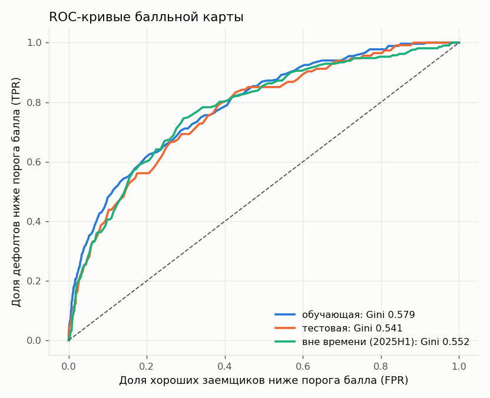
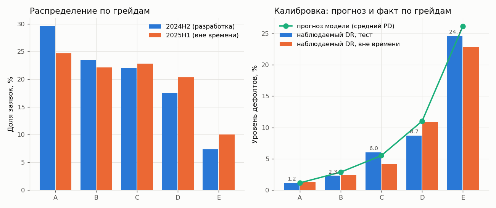

# Скоринговая модель (балльная карта МСП)

Статус: **версия `scorecard-2026.10-v1`, обучена на синтетике**. Конфиг: [analytics/artifacts/scorecard.v1.json](../../analytics/artifacts/scorecard.v1.json), схема полей: [analytics/artifacts/README.md](../../analytics/artifacts/README.md). Все числа ниже воспроизводятся командой `uv run --python 3.12 python -m src.build_all` (сводка в `analytics/artifacts/build_report.json`).

Скоринг отвечает только на вопрос "насколько рискован заемщик". Продукт, сумма и срок заявки в балл не входят: их учитывает кредитная политика ([decision-policy.md](decision-policy.md)). Стоп-факторы (ликвидация, недостоверность, текущая просрочка от 30 дней, недоимка от 100 000 руб., комплаенс) тоже не признаки скоринга, а правило POL-01 политики.

## 1. Данные

Генератор и скрытый процесс дефолта описаны в [synthetic-data.md](synthetic-data.md). Коротко:

| Выборка | Что это | Заявок | Дефолтов | DR |
|---|---|---|---|---|
| Популяция | 12 000 синтетических заявок МСП, две когорты по дате заявки | 12 000 | | |
| Исключены | заявки со стоп-фактором POL-01 (по ним кредит не выдается, исхода нет) | 1 826 | | |
| Обучающая (train) | когорта 2024H2, 70% | 4 771 | 267 | 5,60% |
| Тестовая (test) | когорта 2024H2, 30%, стратифицировано по дефолту | 2 045 | 114 | 5,57% |
| Вне времени (OOT) | когорта 2025H1: моложе бизнесы, больше запросов в БКИ, чуть хуже экономика | 3 358 | 212 | 6,31% |

Целевое событие: дефолт (просрочка 90+ дней) в течение 12 месяцев после выдачи. Обе когорты имеют полный период наблюдения на дату отчета.

## 2. Методика

1. **Признаки-кандидаты.** 17 признаков из [data-requirements.md](../process/data-requirements.md) и [decision-model.md](../process/decision-model.md), раздел 7: возраст бизнеса, тип заявителя, отраслевая группа ОКВЭД, подтвержденная выручка и ее динамика, рентабельность (ГИР БО), долговая нагрузка (платежи / среднемесячная выручка), БКИ (максимальная просрочка за 12 мес., запросы за 30 и 90 дней, длина истории, число кредитов), налоговая недоимка, массовый адрес или руководитель, нестабильность оборотов, численность, отношение запрошенной суммы к выручке. Точные формулы в `analytics/src/oracle/features.py`, их же использует бэкенд.
2. **Биннинг.** Стартовые границы задаются "человеческими" числами (6, 12, 24 мес.; 500 тыс., 2 млн руб.; 10%, 15% и т.д.). Бины с долей меньше 5% сливаются с соседом с ближайшим уровнем дефолта, затем соседние бины сливаются до монотонного WoE в ожидаемом направлении (например, чем больше возраст бизнеса, тем ниже риск). Пропуск всегда отдельный бин.
3. **WoE и IV.** WoE = ln(доля хороших / доля плохих) со сглаживанием 0,5; IV = сумма (доля хороших - доля плохих) x WoE.
4. **Отбор.** IV не меньше 0,02; монотонность; попарная корреляция WoE не больше 0,6 (из пары остается признак с большим IV); в многофакторной модели знак коэффициента должен быть правильным, а вклад заметным (|коэффициент| не меньше 0,15), иначе признак исключается и модель переобучается. Плюс экспертные исключения по смыслу (таблица ниже).
5. **Модель.** Логистическая регрессия на WoE (scikit-learn, L2 со слабой регуляризацией C = 100).
6. **Шкалирование (PDO).** 600 баллов соответствуют шансам "хороший : плохой" 50 : 1, удвоение шансов дает +20 баллов. factor = 20 / ln 2 = 28,8539; offset = 600 - factor x ln 50 = 487,1229. Баллы бина = round(-factor x коэффициент x WoE), базовый балл = round(offset - factor x свободный член) = **570**. Балл заявки = 570 + сумма баллов 11 факторов; диапазон от 407 до 673.
7. **Экспертная корректировка.** Бин "нет данных" не может давать положительных баллов (ограничен нулем). На синтетике у заемщиков без кредитной истории дефолтность низкая (4,2%), и модель дала бы им бонус до +16 баллов по трем факторам БКИ; для реального кредитования это неприемлемо, поэтому бонус обнулен.
8. **Грейды.** Границы получены из целевых PD через ту же шкалу (PD 2%, 4%, 8%, 15%) и округлены до 5 баллов. `pd_by_grade` равен наблюдаемому уровню дефолтов на отложенной выборке (test и OOT вместе).

### 2.1. Отбор признаков

| Признак | IV | Решение |
|---|---|---|
| `bki_max_delinquency_days_12m` | 0,432 | включен |
| `bki_inquiries_90d` | 0,275 | включен |
| `turnover_volatility` | 0,254 | включен |
| `confirmed_monthly_revenue` | 0,232 | включен |
| `net_margin` | 0,225 | включен |
| `business_age_months` | 0,207 | включен |
| `revenue_growth` | 0,197 | включен |
| `employees_count` | 0,191 | исключен: корреляция WoE с выручкой 0,76 (дублирует масштаб бизнеса) |
| `requested_amount_to_revenue` | 0,144 | исключен по смыслу: параметр заявки; по decision-model.md (раздел 7) сумма и срок учитываются политикой через долговую нагрузку, иначе контрпредложение меняло бы грейд |
| `debt_load_ratio` | 0,096 | включен |
| `bki_credit_history_months` | 0,093 | включен |
| `bki_inquiries_30d` | 0,084 | исключен: после запросов за 90 дней коэффициент получает неверный знак (информация уже учтена) |
| `tax_arrears_flag` | 0,055 | включен |
| `applicant_type` | 0,045 | исключен: корреляция WoE с выручкой 0,64 (ИП в среднем меньше) |
| `industry_risk_group` | 0,038 | включен |
| `bki_active_loans_count` | 0,012 | исключен: IV меньше 0,02 |
| `fns_mass_registration` | 0,000 | исключен: массовый адрес и руководитель являются стоп-фактором политики (`unreliable_flags`), в выборке без стоп-факторов признак не меняется |

## 3. Факторы и баллы

Базовый балл **570**. Интервал "от a до b" означает a <= x < b.

| Фактор | Интервал или значение | Баллы | Доля в обучении | DR в бине |
|---|---|---|---|---|
| Максимальная просрочка за 12 мес., дней | меньше 1 | +8 | 77,5% | 4,0% |
|  | 1 и больше | -28 | 12,4% | 17,0% |
|  | нет данных (нет кредитной истории) | 0 (до ограничения +7) | 10,1% | 4,2% |
| Запросы в БКИ за 90 дней | меньше 2 | +13 | 41,4% | 3,1% |
|  | от 2 до 3 | -1 | 22,8% | 5,8% |
|  | от 3 до 4 | -8 | 14,0% | 8,0% |
|  | 4 и больше | -19 | 11,8% | 12,3% |
|  | нет данных | 0 (до ограничения +6) | 10,1% | 4,2% |
| Нестабильность оборотов (коэффициент вариации) | меньше 10% | +13 | 8,2% | 2,3% |
|  | от 10% до 15% | +7 | 20,6% | 3,5% |
|  | от 15% до 20% | +3 | 19,5% | 4,6% |
|  | от 20% до 25% | +1 | 14,7% | 5,3% |
|  | от 25% до 30% | -6 | 8,9% | 8,0% |
|  | 30% и больше | -14 | 11,1% | 13,0% |
|  | нет данных (нет счета или меньше 6 мес.) | 0 (до ограничения +1) | 17,0% | 5,1% |
| Подтвержденная выручка в месяц, руб. | меньше 500 000 | -15 | 8,6% | 10,7% |
|  | от 500 000 до 2 000 000 | -7 | 30,5% | 7,5% |
|  | от 2 000 000 до 3 000 000 | +6 | 11,2% | 4,1% |
|  | от 3 000 000 до 10 000 000 | +7 | 28,0% | 4,0% |
|  | 10 000 000 и больше | +23 | 12,5% | 1,8% |
|  | нет данных | -2 | 9,1% | 6,0% |
| Рентабельность по чистой прибыли (ГИР БО) | меньше -5% | -10 | 2,9% | 11,0% |
|  | от -5% до 0% | -2 | 5,4% | 6,2% |
|  | от 0% до 3% | 0 | 4,5% | 5,6% |
|  | от 3% до 6% | +12 | 5,7% | 2,2% |
|  | от 6% до 15% | +13 | 13,7% | 2,1% |
|  | 15% и больше | +16 | 5,7% | 1,5% |
|  | нет данных (ИП, нет отчетности) | -3 | 62,0% | 6,8% |
| Возраст бизнеса, мес. | меньше 12 | -12 | 9,8% | 12,2% |
|  | от 12 до 24 | -4 | 22,9% | 7,3% |
|  | от 24 до 36 | +2 | 17,6% | 4,9% |
|  | от 36 до 60 | +4 | 21,3% | 4,1% |
|  | от 60 до 120 | +5 | 19,3% | 3,8% |
|  | 120 и больше | +9 | 9,1% | 2,8% |
|  | нет данных | 0 | 0,0% | |
| Динамика выручки | меньше -15% | -10 | 8,6% | 10,7% |
|  | от -15% до -5% | -2 | 13,8% | 6,2% |
|  | от -5% до 5% | +5 | 22,2% | 4,0% |
|  | 5% и больше | +7 | 34,9% | 3,5% |
|  | нет данных | -6 | 20,4% | 8,3% |
| Долговая нагрузка (платежи / выручка) | меньше 10% | +4 | 79,9% | 4,8% |
|  | от 10% до 15% | -10 | 11,2% | 7,8% |
|  | 15% и больше | -17 | 8,9% | 10,4% |
|  | нет данных | 0 | 0,0% | |
| Длина кредитной истории, мес. | меньше 12 | -8 | 10,1% | 10,2% |
|  | от 12 до 60 | 0 | 59,0% | 5,7% |
|  | 60 и больше | +4 | 20,8% | 3,8% |
|  | нет данных | 0 (до ограничения +3) | 10,1% | 4,2% |
| Налоговая недоимка (ниже порога отказа) | нет | +1 | 95,6% | 5,3% |
|  | есть | -21 | 4,4% | 12,4% |
| Отраслевая группа риска (ОКВЭД) | низкий (опт, IT, профуслуги, медицина, пищевое производство) | +5 | 30,4% | 4,7% |
|  | средний (розница, транспорт, автосервис, прочее производство, услуги; класс вне справочника) | +2 | 45,1% | 5,2% |
|  | высокий (общепит, гостиницы, строительство, аренда недвижимости, сельское хозяйство, развлечения, туризм) | -9 | 24,6% | 7,4% |

Справочник "класс ОКВЭД → группа" в `feature_parameters.okved_risk_groups` конфига.

Пример (сценарий S2, ООО "Эскиз-Климат"): 570 + 8 (без просрочек) + 13 (1 запрос) + 13 (вариация 4,5%) + 7 (выручка 7,45 млн) + 13 (рентабельность 7%) + 5 (72 мес.) + 5 (динамика +4,6%) - 10 (нагрузка 12,75%) + 4 (история 66 мес.) + 1 (нет недоимки) - 9 (строительно-монтажные работы) = **620, грейд A**.

## 4. Грейды

| Грейд | Балл | Целевой PD | Доля (2024H2) | Доля (2025H1) | DR на отложенной выборке | 95% ДИ | `pd_by_grade` |
|---|---|---|---|---|---|---|---|
| A | 600 и выше | до 2% | 29,6% | 24,7% | 1,27% (18 из 1 422) | 0,80-1,99% | 0.0127 |
| B | 580-599 | 2-4% | 23,4% | 22,1% | 2,37% (29 из 1 225) | 1,65-3,38% | 0.0237 |
| C | 560-579 | 4-8% | 22,1% | 22,8% | 4,88% (60 из 1 230) | 3,81-6,23% | 0.0488 |
| D | 535-559 | 8-15% | 17,5% | 20,3% | 10,11% (105 из 1 039) | 8,42-12,09% | 0.1011 |
| E | ниже 535 | больше 15% | 7,4% | 10,0% | 23,41% (114 из 487) | 19,87-27,37% | 0.2341 |

Уровень дефолтов монотонно растет от A к E, интервалы соседних грейдов почти не пересекаются, каждый грейд содержит не меньше 7% выборки. Как грейды превращаются в решение (зеленая, серая зона, отказ по продуктам), описано в [decision-policy.md](decision-policy.md).

## 5. Качество модели

### 5.1. Различающая способность

| Выборка | ROC-AUC | Gini | KS | Brier |
|---|---|---|---|---|
| train | 0,789 | **0,579** | 0,418 | 0,0471 |
| test | 0,771 | **0,541** | 0,407 | 0,0486 |
| OOT 2025H1 | 0,776 | **0,552** | 0,451 | 0,0548 |

KS считается только на границах групп одинакового балла: `max |TPR - FPR|` по ROC для `-score`. Строки с равными баллами входят в порог вместе; их порядок не меняет результат. Для постоянного балла KS = 0. Формулы и знаменатели: [metrics.md](metrics.md), раздел 5.

Разница Gini между train и test составляет около 0,04; на синтетической выборке вне времени Gini не снижается относительно test. Эти числа описывают поведение на синтетике и не подтверждают качество на реальных кредитах.

### 5.2. Стабильность (PSI между 2024H2 и 2025H1)

| Что сравнивается | PSI | Вывод |
|---|---|---|
| Балл (децили разработки) | **0,026** | стабильно (меньше 0,1) |
| Распределение грейдов | 0,023 | стабильно |
| Запросы в БКИ за 90 дней | 0,095 | на границе зоны внимания: в 2025H1 заемщики чаще обращаются в другие банки; мониторить |
| Возраст бизнеса | 0,011 | стабильно |
| Динамика выручки | 0,008 | стабильно |
| Остальные 8 факторов | от 0,0001 до 0,006 | стабильно |
| Грейды: синтетический поток последних 90 дней (история для BK-06) против разработки | 0,020 | стабильно |

Шкала PSI: меньше 0,1 стабильно, 0,1-0,25 нужен анализ, больше 0,25 модель требует пересмотра.

### 5.3. Калибровка (точность)

| Грейд | Прогноз модели, тест | Факт, тест | Прогноз, OOT | Факт, OOT |
|---|---|---|---|---|
| A | 1,14% | 1,18% | 1,19% | 1,33% |
| B | 2,85% | 2,28% | 2,90% | 2,42% |
| C | 5,51% | 6,05% | 5,47% | 4,17% |
| D | 11,02% | 8,71% | 10,85% | 10,83% |
| E | 26,19% | 24,67% | 27,81% | 22,85% |

Прогноз модели (средний PD из балла) попадает в 95% доверительный интервал наблюдаемого уровня по всем грейдам на тестовой выборке; на OOT общий уровень дефолтов вырос с 5,6% до 6,3% при почти неизменном прогнозе, что ожидаемо при ухудшении экономики когорты. Поэтому `pd_by_grade` берется по факту отложенной выборки, а не из формулы шкалы.

## 6. Как бэкенд считает балл

1. Из ответов источников и анкеты вычислить 11 признаков по `factors[].definition` (эталон: `analytics/src/oracle/features.py`).
2. Для каждого фактора найти бин (`lower <= x < upper` или `x in values`, иначе `missing`) и взять `points`.
3. `score = base_points + сумма points`, грейд по `grade_bands`, `pd = pd_by_grade[grade]`.
4. Сохранить `factor_contributions[]` для карточки андеррайтера и `scorecard_version`.

Совпадение реализации проверяется golden-файлом `analytics/artifacts/expected_outcomes.json` (63 случая, включая заявки ровно на границах грейдов 600/599, 580/579, 560/559, 535/534).

## 7. Ограничения и что делать с реальными данными

1. **Модель обучена на синтетике.** Связи признаков с дефолтом заданы генератором, поэтому числа качества показывают работоспособность методики и конвейера, а не реальную предсказательную силу. Перед использованием на реальных данных карта переобучается целиком тем же кодом (`src/model.py`).
2. **Смещение отбора (reject inference).** Обучение только на одобренных заявках недооценивает риск отклоненных. На реальных данных нужна оценка отказников (например, по поведению в других банках через БКИ) или экспериментальное одобрение части заявок в серой зоне.
3. **Окно и определение дефолта.** На реальных данных нужно зафиксировать определение (90+ дней за 12 мес. с даты выдачи, реструктуризация как дефолт) и проверить достаточность событий: ориентир не меньше 300-500 дефолтов на разработку.
4. **Регулярная валидация.** Ежеквартально: Gini на свежей когорте (порог пересмотра: падение больше 0,05 или ниже 0,45), PSI балла и факторов (порог 0,1 для анализа, 0,25 для пересмотра), биномиальный тест калибровки по грейдам. Отдельно отслеживать PSI запросов в БКИ (на синтетике 0,095).
5. **Справочник отраслей.** Группы ОКВЭД заданы экспертно для 22 классов, остальные получают средний риск; на реальных данных группы строятся по уровню дефолтов отраслей и пересматриваются раз в год.
6. **Регуляторные требования.** Использование модели в кредитном решении требует документации, независимой валидации и утверждения в банке; на хакатоне эти процедуры обозначены, но не выполняются.
