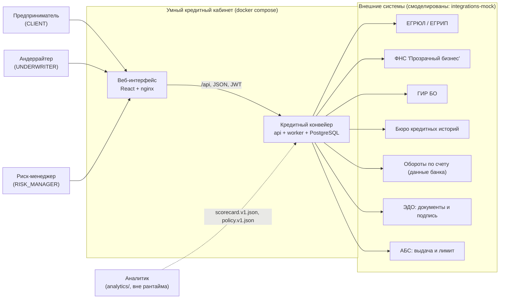
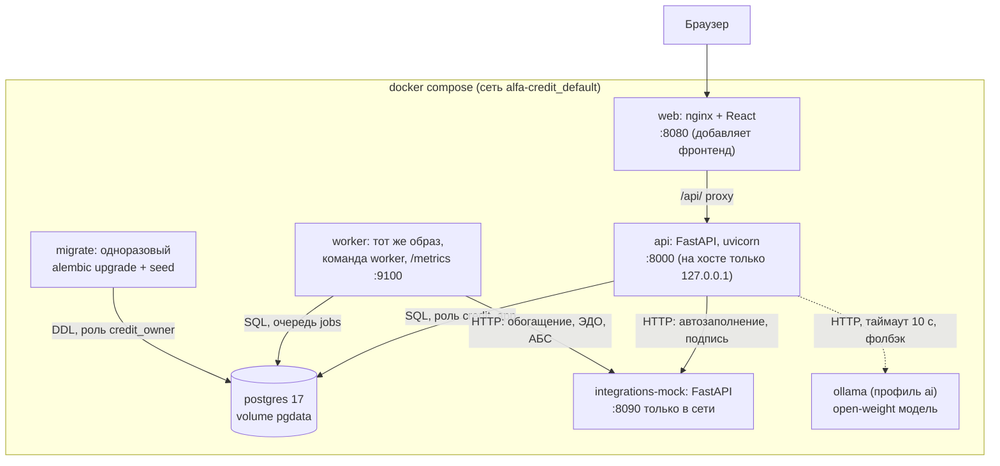
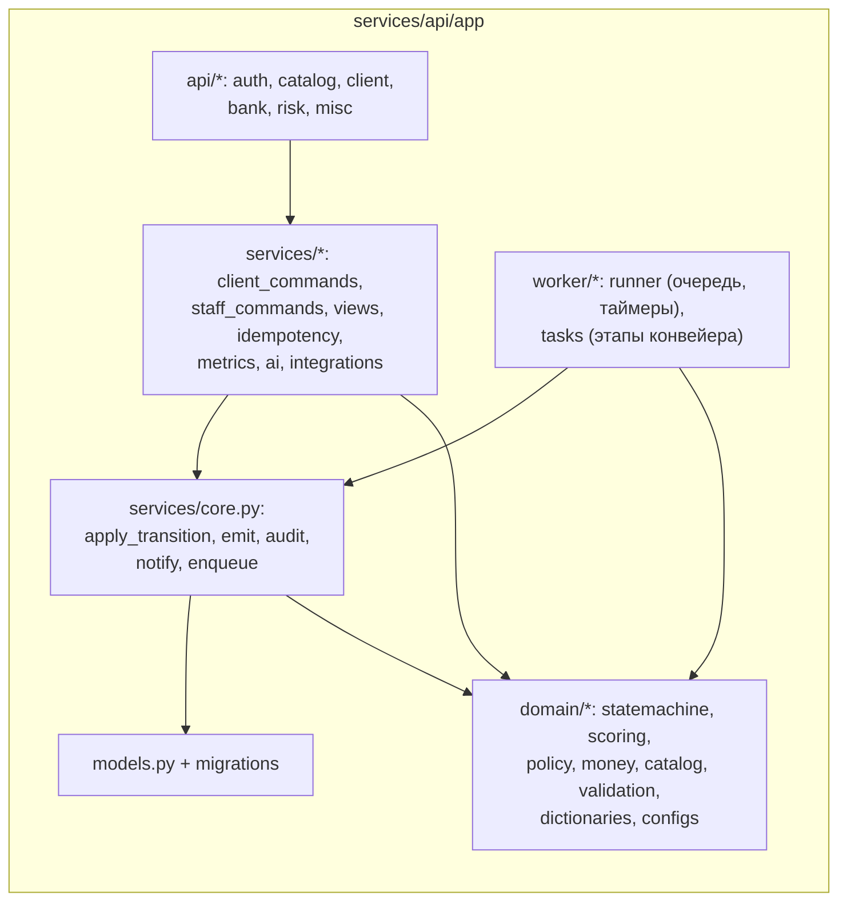
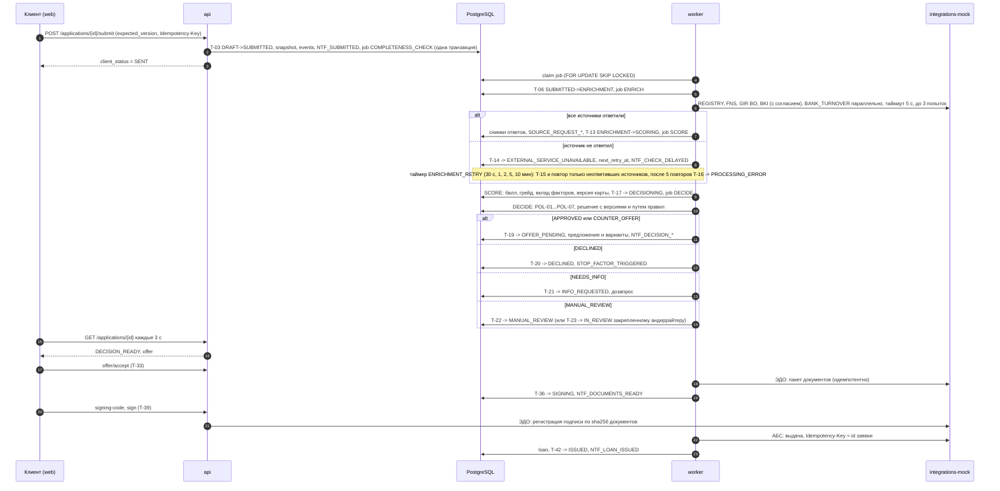

# Архитектура кредитного конвейера

Документ описывает, из чего состоит бэкенд прототипа, как данные проходят от клиента до выдачи и почему приняты основные технические решения. Процессная модель (статусы, роли, правила решения) описана в [docs/process](../process/README.md), модель данных в [data-model.md](data-model.md), безопасность в [security.md](security.md), надежность в [reliability.md](reliability.md), решения в [adr/](adr/).

## 1. Контекст

Весь путь клиента проходит внутри продукта: уведомления и код подписания показываются в кабинете, email и SMS не используются. Внешние системы воспроизводятся сервисом `integrations-mock` с упрощенными контрактами, сохраняющими смысл интеграции: запрос, ответ, коды ошибок, идентификатор запроса, согласие для БКИ, идемпотентность операций ЭДО и АБС.

## 2. Контейнеры

| Контейнер | Ответственность | Масштабирование |
|---|---|---|
| `api` | REST API, аутентификация, проверка прав, синхронные команды (черновик, отправка, решения сотрудников, подпись), чтение карточек и метрик | без состояния, любое число реплик за nginx (ключ JWT в БД или в `JWT_SECRET`) |
| `worker` | задачи конвейера из очереди `jobs` (полнота, обогащение, скоринг, решение, документы, выдача), таймеры (повторы, истечение предложений и дозапросов, SLA), outbox | несколько процессов (`WORKER_REPLICAS`): задача достается одному через `FOR UPDATE SKIP LOCKED` |
| `migrate` | миграции Alembic и идемпотентный seed (тестовые пользователи, компании, синтетическая история) под ролью владельца схемы | запускается один раз перед api и worker |
| `postgres` | единственный источник истины: данные, очередь, журнал событий, аудит | volume `pgdata`, healthcheck `pg_isready` |
| `integrations-mock` | симуляторы REGISTRY, FNS, FINANCIAL_STATEMENTS, CREDIT_BUREAU, BANK_TURNOVER, EDO, ABS; задержки и сбои по ИНН или переключателю | не хранит ничего важного: состояние в памяти |
| `ollama` | необязательная локальная модель с открытыми весами для резюме и пояснений | только профиль `ai` |

## 3. Компоненты бэкенда

* **`domain/statemachine.py`**: декларативная таблица переходов T-01...T-46 (из, в, триггер, роли, guards). По ней проверяется каждая команда и строится `available_actions`.
* **`services/core.py`**: единственная точка смены статуса `apply_transition()`: проверка перехода, роли, guards и `expected_version`, условный `UPDATE`, история статусов, событие `STATUS_CHANGED`, аудит. Доменные события, уведомления и задачи воркера добавляются в ту же транзакцию.
* **`domain/scoring.py`, `domain/policy.py`, `domain/money.py`**: балльная карта и правила POL-01...POL-07 на `Decimal`, без ML-библиотек; параметры только из конфигов. Совпадение с эталоном проверяется 63 golden-случаями.
* **`domain/configs.py`**: загрузка `scorecard.v1.json` и `policy.v1.json` из `analytics/artifacts` с проверкой схемы, версии и sha256; версии пишутся в каждый результат скоринга и решение, загрузка фиксируется событием `CONFIG_VERSION_LOADED`.
* **`services/views.py`**: две модели чтения. Клиентская отдает `client_status`, тексты и предложение и проходит через строгую схему `ClientApplication` (лишнее поле приводит к ошибке, а не к утечке). Карточка сотрудника отдает все: источники, факторы, правила, историю.
* **`worker/`**: цикл воркера, задачи этапов и таймеры.

## 4. Потоки данных

| Поток | Откуда и куда | Данные | Защита |
|---|---|---|---|
| Анкета и команды клиента | браузер, nginx, api, PostgreSQL | анкета, согласия, документы, ответы | JWT, проверка владельца, валидация, лимиты размера, аудит |
| Автозаполнение | api, мок REGISTRY и FNS | ИНН, сведения реестра | таймаут 5 с, при сбое заявка продолжается без автозаполнения |
| Обогащение | worker, 5 моков | ИНН, ссылка на согласие (для БКИ) | согласие проверяется до запроса, ответы сохраняются снимками на 24 ч |
| Скоринг и решение | worker внутри процесса | признаки, балл, грейд, путь правил | версии и sha256 конфигов в каждом решении |
| Документы и подпись | worker и api, мок ЭДО | условия, график, хеши документов | подпись привязана к sha256 документов, код только в кабинете |
| Выдача | worker, мок АБС | сумма, срок, ставка | ключ идемпотентности = id заявки |
| Метрики | api, журнал `events` | коды событий, суммы, длительности | в событиях нет персональных данных |

## 5. Обработка заявки воркером

## 6. Принятые решения

| Решение | Почему | ADR |
|---|---|---|
| Очередь задач и таймеры на PostgreSQL (`jobs`, `FOR UPDATE SKIP LOCKED`) | одна транзакция для статуса и задачи, без брокера и без потери задач; достаточно для нагрузки прототипа | [0001](adr/0001-postgres-queue.md) |
| Стейт-машина как декларативная таблица и одна точка смены статуса | переходы проверяются и показываются из одного источника; запрещенное невозможно выполнить в обход | [0002](adr/0002-state-machine-table.md) |
| Скоринг и политика как версионируемые JSON-конфиги аналитика | разделение оценки риска и решения, воспроизводимость, golden-тест | [0003](adr/0003-versioned-configs.md) |
| Внешние системы как отдельный сервис-симулятор | реальные HTTP-сбои, таймауты и идемпотентность, а не заглушки в коде | [0004](adr/0004-integrations-mock-service.md) |
| JWT access + одноразовый refresh в HttpOnly cookie, роли из токена | stateless api, короткий срок токена, отзыв через refresh | [0005](adr/0005-authentication.md) |
| ИИ только как необязательный модуль с шаблонным фолбэком | основной сценарий не зависит от модели, решение по кредиту детерминированное | [0006](adr/0006-optional-ai.md) |
| Синхронный SQLAlchemy 2 + psycopg 3 | проще и надежнее транзакции и блокировки; FastAPI выполняет синхронные обработчики в пуле потоков | |
| Файлы клиентов в БД (`document_contents`) | один источник истины, транзакционность и бэкап вместе с данными; лимит 10 МБ и 20 файлов на заявку. Для промышленной эксплуатации объектное хранилище с шифрованием | |
| Конфиги и демо-данные берутся из `analytics/artifacts` при сборке образа (контекст сборки: корень репозитория) | нет копий файлов в репозитории, версия и sha256 проверяются при старте | |

## 7. Отклонения и уточнения спецификации

* **Документы ЭДО** формируются в текстовом виде (UTF-8) с sha256, а не PDF: генерация PDF с кириллицей потребовала бы шрифтов и библиотек без ценности для демонстрации. Подпись привязана к хешам именно этих текстов.
* **Проверка кода подписания** выполняется api (код хранится как HMAC, 3 попытки, 5 минут), а мок ЭДО регистрирует подпись и сверяет хеши документов пакета. Неверная попытка фиксируется отдельной транзакцией, чтобы откат команды не обнулял счетчик.
* **Компания и представитель.** Клиент видит заявки, где он автор, и заявки компаний, членом которых является. Первый представитель ИНН закрепляется автоматически (подтверждение полномочий согласием `AUTHORITY_CONFIRMATION`, допущение A-11); заявка по ИНН, закрепленному за другим клиентом, отклоняется `403 COMPANY_ACCESS_DENIED`.
* **Ответы REGISTRY и FNS из автозаполнения** сохраняются снимками и переиспользуются на этапе обогащения в течение 24 часов (тот же кеш, что и при повторном прохождении после дозапроса).
* **Проигравший в гонке "Взять в работу"** получает `409 ALREADY_TAKEN` с именем коллеги, хотя заявка уже вне его вкладок.
* **Синтетическая история** импортируется как заявки с признаком `is_history`: они видны в списках и метриках, но только для чтения и не обрабатываются таймерами.
* **Пункт дозапроса** имеет один тип ответа, поэтому "текст + поле выручки" из сценария S3 оформляется двумя пунктами с одним кодом `NI_DATA_MISMATCH_EXPLANATION`.
