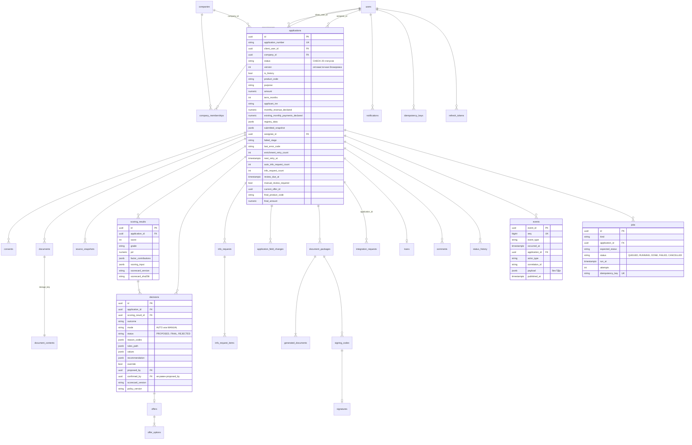

# Модель данных

PostgreSQL 17, схема создается миграциями Alembic: `0001` задает исходную схему, [0002](../../services/api/migrations/versions/0002_durable_integration_requests.py) добавляет `integration_requests` и `loans.payment_schedule`. Ниже схема прототипа, а не подтверждение применения миграций на конкретном стенде. Результаты проверок: [audit-fixes.md](../testing/audit-fixes.md). Словарь полей и правила валидации: [data-requirements.md](../process/data-requirements.md); статусы и служебные поля заявки: [application-states.md](../process/application-states.md), раздел 2; события: [events.md](../process/events.md).

Общие правила:

* идентификаторы UUID (кроме журналов с последовательным `bigint`); номер заявки для людей `A-000123` из последовательности `application_number_seq`;
* деньги `NUMERIC(18,2)`, ставки `NUMERIC(6,2)`, доли в JSON строками; время `timestamptz` в UTC;
* справочники процесса (статусы, роли, типы согласий и документов, исходы, коды ошибок) закреплены `CHECK`-ограничениями и совпадают с enum в коде;
* журналы `events`, `audit_log`, `status_history` только для вставки: триггеры запрещают изменение и удаление (у `events` разрешено только проставить `published_at` при отправке из outbox);
* api и worker подключаются ролью `credit_app` без прав на DDL; миграции выполняет владелец схемы `credit_owner`.

## 1. ER-диаграмма

## 2. Таблицы

### 2.1. Пользователи и доступ

| Таблица | Назначение | Ключевые поля и ограничения |
|---|---|---|
| `users` | тестовые учетные записи и синтетические клиенты истории | `login` уникален, `password_hash` (argon2id, у исторических клиентов пусто и `is_active = false`), `role` CHECK `CLIENT`, `UNDERWRITER`, `RISK_MANAGER` |
| `companies` | заявитель (ООО или ИП) по ИНН | `inn` уникален, `applicant_type` |
| `company_memberships` | кто представляет компанию | уникальная пара пользователь и компания; привязка используется для доступа к компании, доступ к заявке проверяется отдельно по владельцу |
| `refresh_tokens` | одноразовые refresh-токены | хранится только sha256, `family_id` для отзыва цепочки при повторном использовании |
| `login_attempts` | ограничение частоты входа | индексы по логину и IP со временем |
| `idempotency_keys` | результат команды по ключу | уникальная пара пользователь и ключ, хеш запроса, сохраненный ответ; хранится 24 часа |
| `system_secrets` | ключ подписи JWT и перец кодов подписания, если не заданы переменные окружения | создаются один раз, общие для всех реплик |

### 2.2. Заявка и анкета

| Таблица | Назначение | Ключевые поля и ограничения |
|---|---|---|
| `applications` | заявка: анкета клиента, сведения реестров, служебные поля стейт-машины, итоговые условия | `status` CHECK, `version >= 1`, частичный уникальный индекс `uq_app_active_inn_product`: одна активная (не черновик и не терминальная) заявка на ИНН и продукт; частичный индекс `ix_app_retry` для таймера повторов; `score` и `grade` денормализованы для списков (источник истины `scoring_results`) |
| `application_field_changes` | изменения анкеты после отправки (ответы на дозапрос) | поле, старое и новое значение, дозапрос, автор |
| `consents` | согласия с фиксацией для аудита | тип CHECK, версия и sha256 текста, `granted_at` по времени сервера, `expires_at` (БКИ 6 месяцев), `revoked_at`, IP, user agent |
| `documents`, `document_contents` | файлы клиента | MIME CHECK (PDF, JPEG, PNG по сигнатуре), размер до 10 МБ, sha256, связь с пунктом дозапроса; квота до подачи 20 на заявку, при дозапросе 20 на пункт с сохранением старых файлов; содержимое отдельно от метаданных |
| `info_requests`, `info_request_items` | дозапросы: источник (`COMPLETENESS_CHECK`, `POLICY`, `UNDERWRITER`), срок, пункты с кодом `NI_*`, типом ответа и ответами | статус `OPEN`, `ANSWERED`, `EXPIRED`, `CANCELLED` |

### 2.3. Внешние данные, скоринг, решение

| Таблица | Назначение | Ключевые поля и ограничения |
|---|---|---|
| `source_snapshots` | каждая попытка запроса к источнику | источник CHECK, этап (`PREFILL`, `ENRICH`), номер попытки, исход (`SUCCESS`, `NO_DATA`, `FAILED`), код ошибки, HTTP-статус, id запроса во внешней системе, длительность, тело ответа, `valid_until` (кеш 24 ч) |
| `scoring_results` | балл, грейд, PD, признаки, вклад факторов, вход скоринга целиком | версия и sha256 карты, дата расчета |
| `decisions` | решения политики и людей | исход и режим CHECK, статус `PROPOSED`/`FINAL`/`REJECTED`, коды причин и подстановки, путь правил, промежуточные значения POL-04, рекомендация, переопределение, автор, подтвердивший (CHECK `confirmed_by <> proposed_by`), версии и sha256 политики |
| `offers`, `offer_options` | предложение и варианты | срок действия, выбранный вариант, тип варианта CHECK, суммы, ставка, платеж, итого, переплата, требования, лимит линии |

### 2.4. Оформление и выдача

| Таблица | Назначение |
|---|---|
| `document_packages`, `generated_documents` | пакет документов от ЭДО: номер договора, операция ЭДО, тексты документов и их sha256 |
| `integration_requests` | намерение операции ЭДО/АБС, фиксируемое до внешнего вызова: `idempotency_key` (PK), `application_id` (FK), `system`, `request` (JSONB), `response` (JSONB, может отсутствовать), `created_at`; индекс по заявке. Повтор использует сохраненный запрос и результат по тому же ключу |
| `signing_codes` | одноразовые коды: HMAC кода (сам код не хранится), хеши документов, срок 5 минут, число попыток, использован или аннулирован |
| `signatures` | факт подписи: код, хеши документов, время, IP, user agent, id подписи в ЭДО; одна на заявку |
| `loans` | выдача: номер договора, маскированный счет, тип операции (`DISBURSEMENT`, `CREDIT_LINE_LIMIT`), условия, дата первого платежа, `abs_operation_id` (уникален); одна на заявку. `payment_schedule` (JSONB, nullable) сохраняет график из подписанного пакета, переданный АБС, для последующего чтения без пересчета по текущей дате |

Восстановление результата неизвестного исхода: [reliability.md](reliability.md#1-идемпотентность). Наличие durable-запроса в БД не делает симулятор внешней системы промышленным хранилищем. Для старых записей без `payment_schedule` сохраненный график не появляется автоматически; это отдельная граница данных после миграции.

### 2.5. Процесс, журналы, уведомления

| Таблица | Назначение |
|---|---|
| `status_history` | каждая смена статуса: из, в, переход T-xx, триггер, исполнитель, версия, время (для таймлайна клиента и SLA) |
| `events` | доменные события и outbox: тип, время, заявка, тип и id исполнителя, `correlation_id`, версия заявки, полезная нагрузка без ПДн; источник метрик |
| `audit_log` | кто, что, когда, откуда: команды, входы, отказы в доступе, просмотры карточек и скачивания документов (IP, user agent, request id) |
| `jobs` | очередь воркера: тип задачи, ожидаемый статус, время запуска, попытки, блокировка, последняя ошибка, ключ идемпотентности (например `ISSUE_LOAN:{id}`) |
| `comments` | внутренние комментарии сотрудников и комментарии к решениям; клиенту не отдаются |
| `notifications` | уведомления в кабинете `NTF_*`; текст с кодом подписания заменяется после истечения или использования кода |
| `config_versions` | загруженные версии скоринговой карты и политики с sha256 и временем загрузки |

## 3. Индексы под основные запросы

| Запрос | Индекс |
|---|---|
| взять следующую задачу | `ix_jobs_ready (run_at) WHERE status = 'QUEUED'` |
| вернуть зависшие задачи | `ix_jobs_running (locked_at) WHERE status = 'RUNNING'` |
| очередь андеррайтера по SLA | `ix_app_status_due (status, review_due_at)` |
| мои заявки клиента | `ix_app_client (client_user_id, updated_at)` |
| таймер повторов обогащения | `ix_app_retry (next_retry_at) WHERE status = 'EXTERNAL_SERVICE_UNAVAILABLE'` |
| история и метрики | `ix_events_app_time`, `ix_events_type_time`, `ix_events_unpublished` |
| кеш ответов источников | `ix_snapshot_lookup (application_id, source, requested_at)` |

## 4. Классификация данных

Классы из [data-requirements.md](../process/data-requirements.md), раздел 8: RESTRICTED (ФИО, ИНН ИП, ответы БКИ, документы, согласия, подписи) хранятся только в своих таблицах и не попадают в `events` и технические логи (в логах ИНН маскируется); SECRET (хеши паролей, коды подписания, ключи) хранятся только в виде хеша или в `system_secrets`/переменных окружения. В прототипе данные не удаляются физически: терминальные статусы являются логическим закрытием; удаленные клиентом документы помечаются `deleted_at`, а их содержимое затирается.
