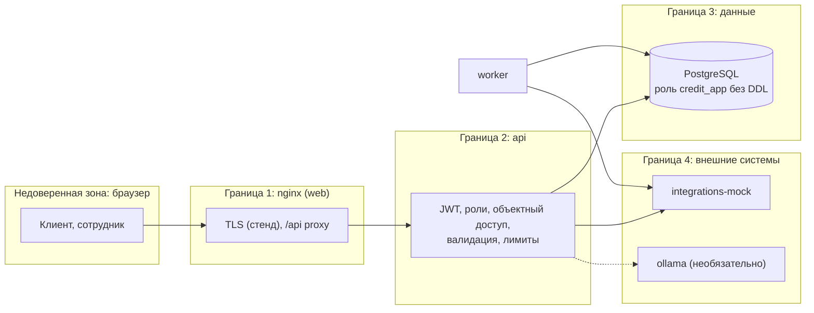

# Безопасность

Статус: описание механизмов прототипа по коду и предложений по развитию. Это не заключение о соответствии законодательству и не результат pentest. Проверка полномочий, юридическая сила подписи, полная а11y и безопасность на реальных данных не верифицированы. [Реестр границ](../product/implementation-status.md).

Краткая модель угроз прототипа, принятые меры и что упрощено. Данные в прототипе только синтетические, но обработка устроена так, как если бы они были настоящими персональными данными и банковской тайной.

## 1. Активы и границы доверия

| Актив | Класс ([data-requirements.md](../process/data-requirements.md), раздел 8) | Где |
|---|---|---|
| ФИО, ИНН ИП, учредители, документы клиента, согласия с IP | RESTRICTED | `applications.registry_data`, `documents`, `consents` |
| Кредитный отчет БКИ, обороты по счету | RESTRICTED / CONFIDENTIAL (банковская тайна) | `source_snapshots` |
| Балл, грейд, пороги политики, решения, комментарии сотрудников | CONFIDENTIAL | `scoring_results`, `decisions`, `comments` |
| Хеши паролей, ключ JWT, коды подписания | SECRET | `users`, `system_secrets`, `signing_codes` (только HMAC) |
| Целостность решения и выдачи | | стейт-машина, журнал событий, аудит |

## 2. STRIDE по границам

| Граница | Угроза (STRIDE) | Мера |
|---|---|---|
| Браузер и api | S: подбор пароля, кража токена | argon2id, лимит 5 попыток на логин и лимит на IP (`429`), одинаковый ответ на неверный логин и пароль, сравнение с фиктивным хешем; access JWT 30 мин с фиксированным алгоритмом HS256 и проверкой `iss`, `aud`, `exp`; refresh только в HttpOnly SameSite=Strict cookie, одноразовый, отзыв цепочки при повторе |
| Браузер и api | T: подмена данных запроса, массовое присвоение | строгие схемы Pydantic (`extra=forbid`), запрет полей статуса, роли, владельца, суммы решения в клиентских DTO; `expected_version` против устаревших экранов; проверка ИНН контрольной суммой, диапазонов, кратности, управляющих символов |
| Браузер и api | R: отказ от действия ("я не подписывал", "я не давал согласие") | согласия с временем сервера, версией и sha256 текста, IP, user agent; подпись привязана к коду, хешам документов, IP; журнал `audit_log` и неизменяемый журнал `events` (триггеры запрещают изменение и удаление) |
| Браузер и api | I: доступ к чужой заявке, утечка внутренних данных | объектная проверка на каждом запросе (клиенту чужая заявка всегда `404`), сотрудники в пределах вкладок, черновики сотрудникам не видны; клиентский ответ проходит строгую схему без балла, грейда, порогов, комментариев и внутреннего статуса; тексты причин по правилам видимости (комплаенс-отказ без деталей); единый формат ошибок без стектрейсов; `Cache-Control: no-store` |
| Браузер и api | D: большие тела, частые запросы | лимит тела 1 МБ для JSON и 11 МБ для документов, документ до 10 МБ; до подачи 20 файлов на заявку, при дозапросе 20 на каждый пункт, прежние файлы сохраняются, лимит кодов подписания 5 в час, таймауты запросов к внешним системам, лимиты памяти контейнеров |
| Браузер и api | E: клиент выполняет команду сотрудника, андеррайтер решает чужую заявку | роль из токена и БД, таблица переходов с ролями и guards (`assignee`, `not_proposer`), 4 глаза для крупных сумм и переопределений, CHECK `confirmed_by <> proposed_by` в БД |
| api и PostgreSQL | T, E: SQL-инъекции, изменение схемы из приложения | только параметризованные запросы SQLAlchemy; api и worker работают ролью `credit_app` без DDL и не владельцем таблиц; миграции отдельной ролью в одноразовом контейнере |
| api, worker и моки | S, T: подмена внешнего ответа, повтор операции | сервис только во внутренней сети, необязательный ключ `X-Api-Key`; проверка структуры ответа (`SOURCE_INVALID_RESPONSE`); идемпотентность ЭДО и АБС по ключу, уникальность выдачи на заявку; БКИ только со ссылкой на действующее согласие |
| api и модель ИИ | I, T: утечка ПДн в модель, prompt injection | в модель только структурированные поля без ФИО и ИНН, свободный текст клиента не передается, ответ проверяется и помечается, на решение не влияет |
| Контейнеры | E: побег, закрепление | непривилегированный пользователь (uid 10001), read-only файловая система, `cap_drop: ALL`, `no-new-privileges`, закрепленные версии образов и lock-файлы зависимостей |

## 3. Заголовки и транспорт

`X-Content-Type-Options: nosniff`, `X-Frame-Options: DENY`, `Referrer-Policy: no-referrer`, `Cross-Origin-Opener-Policy: same-origin`, `Permissions-Policy`, `Content-Security-Policy: default-src 'none'` для API (для `/api/docs` разрешен CDN Swagger UI), `Cache-Control: no-store`, HSTS при `REFRESH_COOKIE_SECURE=true`. CORS только для origin из `CORS_ORIGINS`. TLS терминируется на nginx стенда; api на хосте опубликован только на `127.0.0.1`, PostgreSQL и симулятор наружу не публикуются.

## 4. Персональные данные и 152-ФЗ

* **Согласие.** Три отдельных согласия без предварительных отметок; фиксируются время сервера, версия и sha256 полного текста, IP, user agent, срок (БКИ 6 месяцев). Запрос в БКИ без действующего согласия технически невозможен (проверка воркером и отказ бюро). Отзыв после отправки только отменой заявки.
* **Минимизация.** Клиент вводит только то, что банк не может узнать сам; ПДн не пишутся в события и технические логи (ИНН маскируется `1234******56`), в модель ИИ не передаются.
* **Доступ и учет доступа.** Каждый просмотр карточки (`APPLICATION_VIEWED`) и скачивание документа (`DOCUMENT_DOWNLOADED`) пишутся в журнал с пользователем, временем, IP; журнал аудита и доступа виден риск-менеджеру.
* **Локализация и хранение.** Все данные в одной PostgreSQL внутри контура; внешних облачных сервисов и платных API нет; модель ИИ локальная.
* **Сроки хранения.** В прототипе данные не удаляются физически (логическое закрытие терминальными статусами); удаленный клиентом документ помечается и его содержимое затирается. Для промышленной эксплуатации нужны регламент сроков хранения и уничтожения по 152-ФЗ и банковскому регулированию, процедуры ответов на запросы субъектов.

## 5. Что упрощено в прототипе

| Упрощение | Что нужно для промышленной эксплуатации |
|---|---|
| Вход по логину и паролю тестовых учетных записей, без MFA | вход клиента через интернет-банк, сотрудников через корпоративный IdP (OIDC) с MFA, проверка полномочий представителя по доверенности |
| Код подписания показывается в интерфейсе | усиленная или простая электронная подпись по защищенному каналу |
| Ключ JWT в БД или переменной окружения | секреты в Vault/KMS, ротация ключей с `kid` |
| Файлы в PostgreSQL без шифрования на уровне приложения | объектное хранилище с шифрованием, антивирусная проверка, TLS до БД |
| Шифрование диска и бэкапы не настроены | шифрование томов, резервные копии с проверкой восстановления |
| Ограничение частоты только для входа и кодов подписания | rate limiting на nginx/API-шлюзе для всех маршрутов, WAF |
| Синтетический комплаенс-флаг | проверки ПОД/ФТ, служба безопасности, санкционные списки |
| Демо-эндпоинты управления симулятором (`DEMO_MODE`) | выключаются (`DEMO_MODE=false`) |
