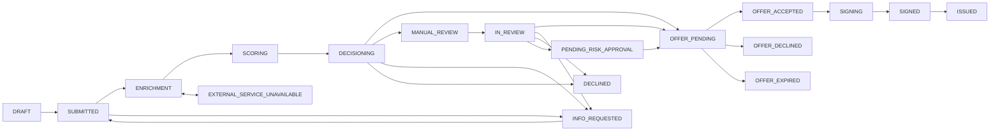

# Кредитный процесс

Процессная спецификация MVP: по ней реализуются стейт-машина, конвейер, права доступа, журнал событий и интерфейсы. Коды статусов, команд, результатов, причин и событий едины для всех документов, БД и API.

| Файл | Содержание | Для кого в первую очередь |
|---|---|---|
| [process-model.md](process-model.md) | границы процесса, участники, этапы ST-01...ST-12 с входами, выходами, результатами и SLA, схема по участникам, sequence diagram основного пути и сбоя источника | все |
| [application-states.md](application-states.md) | **каноническая стейт-машина**: 20 статусов, клиентские статусы и тексты, диаграмма, переходы T-01...T-46 с условиями и эффектами, запрещенные переходы, таймеры | бэкенд, фронтенд, тесты |
| [roles-and-permissions.md](roles-and-permissions.md) | роли, матрица команд по статусам, видимость заявок и данных, принцип 4 глаз, обязательные тесты прав | бэкенд, фронтенд, техлид |
| [decision-model.md](decision-model.md) | разделение скоринга и политики, результаты решения, правила POL-01...POL-07, расчет нагрузки, контрпредложение, конфигурируемые параметры, справочник кодов причин | аналитик, бэкенд |
| [data-requirements.md](data-requirements.md) | словарь полей анкеты с валидацией, контрольная сумма ИНН, автозаполнение, внешние источники, документы, согласия, сущности, классификация данных | бэкенд, аналитик, фронтенд |
| [events.md](events.md) | структура события, каталог доменных событий, формулы метрик, соответствие событиям исследования, уведомления в кабинете | бэкенд, аналитик |

## Краткая карта статусов

Полная диаграмма со всеми переходами, отменами и `PROCESSING_ERROR`: [application-states.md](application-states.md), раздел 4.
