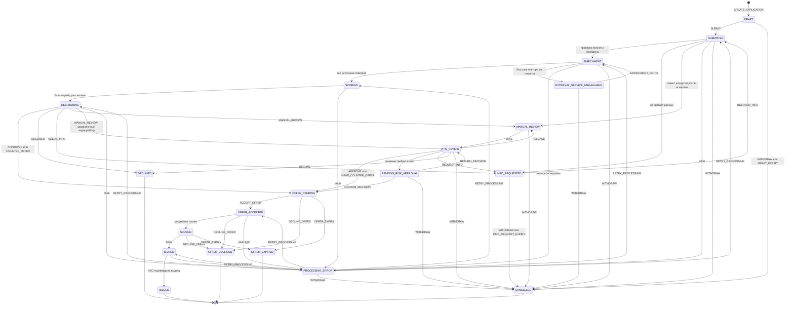

# Стейт-машина заявки (каноническая)

Статус документа: **принято для реализации MVP**. Это единственный источник истины по статусам заявки, переходам и клиентскому отображению. Коды статусов, команд и таймеров используются без изменений в БД, API, воркере, веб-интерфейсе и тестах. Если реализация требует изменить статус или переход, сначала меняется этот документ.

Связанные документы: [process-model.md](process-model.md) (этапы процесса), [decision-model.md](decision-model.md) (результаты решения и коды причин), [roles-and-permissions.md](roles-and-permissions.md) (кто может выполнять команды), [events.md](events.md) (события переходов), [../product/screens.md](../product/screens.md) (что видит пользователь).

## 1. Принципы

1. **Статус отражает, где заявка ждет или кем обрабатывается.** Технические подробности (номер попытки, источник, исполнитель) хранятся в полях заявки, а не в коде статуса.
2. **Каждая смена статуса атомарна**: в одной транзакции БД меняется `status`, увеличивается `version`, пишется запись в журнал событий (outbox) `STATUS_CHANGED` и доменное событие перехода. Переход выполняется условным обновлением `WHERE id = :id AND status = :from AND version = :expected_version`. Если обновлено 0 строк, команда отклоняется с кодом `409 VERSION_CONFLICT` или `409 INVALID_TRANSITION`.
3. **Любой переход, которого нет в таблице раздела 5, запрещен** и возвращает `409 INVALID_TRANSITION` с текущим статусом в ответе.
4. **Команды пользователя идемпотентны**: клиент передает заголовок `Idempotency-Key`; повтор той же команды с тем же ключом возвращает исходный результат, а не выполняет переход повторно.
5. **Клиент не видит внутренние статусы.** Ему показывается упрощенный клиентский статус `client_status` (раздел 3), который вычисляется из внутреннего статуса и нескольких полей заявки. Внутренний код статуса в клиентском API не отдается.
6. **Данные заявки клиент может менять только в `DRAFT`**, а в `INFO_REQUESTED` только запрошенные пункты дозапроса. После отправки сохраняется неизменяемый снимок анкеты (`submitted_snapshot`) для аудита.

## 2. Внутренние статусы

| # | Код | Название для сотрудника | Тип | Кто работает в статусе | Нормативное время (SLA) |
|---|---|---|---|---|---|
| 1 | `DRAFT` | Черновик | рабочий | клиент | до 30 дней без активности (таймер `DRAFT_EXPIRY`) |
| 2 | `SUBMITTED` | Принята, проверка полноты | рабочий, системный | воркер (задача `COMPLETENESS_CHECK`) | до 1 мин |
| 3 | `INFO_REQUESTED` | Дозапрос у клиента | ожидание клиента | клиент | до 14 дней (таймер `INFO_REQUEST_EXPIRY`) |
| 4 | `ENRICHMENT` | Обогащение из внешних источников | рабочий, системный | воркер (задача `ENRICH`) | до 2 мин |
| 5 | `EXTERNAL_SERVICE_UNAVAILABLE` | Внешний сервис недоступен, повтор запланирован | ожидание таймера | воркер (таймер `ENRICHMENT_RETRY`) | до 20 мин суммарно, затем `PROCESSING_ERROR` |
| 6 | `SCORING` | Скоринг | рабочий, системный | воркер (задача `SCORE`) | до 10 сек |
| 7 | `DECISIONING` | Применение кредитной политики | рабочий, системный | воркер (задача `DECIDE`) | до 10 сек |
| 8 | `MANUAL_REVIEW` | В очереди ручного рассмотрения | ожидание сотрудника | андеррайтеры (общая очередь) | взять в работу до 4 ч; решение до 8 ч от входа в очередь |
| 9 | `IN_REVIEW` | На рассмотрении у андеррайтера | рабочий | назначенный андеррайтер (`assignee_id`) | входит в 8 ч SLA ручного рассмотрения |
| 10 | `PENDING_RISK_APPROVAL` | На согласовании у риск-менеджера (4 глаза) | ожидание сотрудника | риск-менеджер | до 4 ч (Should, см. раздел 7) |
| 11 | `OFFER_PENDING` | Предложение направлено клиенту | ожидание клиента | клиент | до 7 дней (таймер `OFFER_EXPIRY`) |
| 12 | `OFFER_ACCEPTED` | Предложение принято, подготовка документов | рабочий, системный | воркер (задача `PREPARE_DOCUMENTS`, мок ЭДО) | до 1 мин |
| 13 | `SIGNING` | Документы на подписании | ожидание клиента | клиент | до истечения предложения `offer.expires_at` |
| 14 | `SIGNED` | Подписано, выдача | рабочий, системный | воркер (задача `ISSUE_LOAN`, мок АБС) | до 1 мин |
| 15 | `PROCESSING_ERROR` | Ошибка обработки, нужен сотрудник | ожидание сотрудника | андеррайтер или риск-менеджер | разобрать до 4 ч |
| 16 | `ISSUED` | Кредит выдан (лимит открыт) | **терминальный** | | |
| 17 | `DECLINED` | Отказ банка | **терминальный** | | |
| 18 | `OFFER_DECLINED` | Клиент отказался от предложения | **терминальный** | | |
| 19 | `OFFER_EXPIRED` | Предложение истекло | **терминальный** | | |
| 20 | `CANCELLED` | Отменена (клиентом или по таймеру) | **терминальный** | | |

**Зачем `PROCESSING_ERROR`.** Это технический, а не кредитный статус. В него заявка попадает, когда автоматические повторы исчерпаны или произошла непредвиденная ошибка (мок не ответил ни на одну попытку, конфиг политики не загрузился, ЭДО или АБС не подтвердили операцию). Без него заявка либо зависает незаметно, либо получает ложный кредитный отказ. В статусе хранится `failed_stage` (статус, в котором произошел сбой) и `last_error_code`; сотрудник видит такие заявки в отдельной вкладке очереди и командой `RETRY_PROCESSING` возвращает заявку в `failed_stage`. Клиент при этом видит не ошибку, а задержку текущего шага (раздел 3).

**Почему `SCORING` и `DECISIONING` отдельные статусы, хотя длятся секунды.** Это прямое отражение требования ТЗ разделять скоринг и решение: у каждого этапа своя задача воркера, свой конфиг и своя версия. Если не загрузилась политика, результат скоринга уже сохранен, и повтор выполняет только `DECIDE`. В журнале и на диаграмме видно, что оценка риска и решение получены разными шагами.

**Поля заявки, которые использует стейт-машина:**

| Поле | Тип | Назначение |
|---|---|---|
| `status` | enum из таблицы выше | текущий статус |
| `version` | int | оптимистичная блокировка, +1 при каждом изменении заявки |
| `assignee_id` | uuid, nullable | андеррайтер, который ведет заявку; сохраняется после дозапроса (правило "закрепления") |
| `failed_stage` | enum статусов, nullable | статус, в котором произошел сбой (только для `PROCESSING_ERROR`) |
| `last_error_code` | string, nullable | технический код ошибки (`SOURCE_TIMEOUT`, `SOURCE_HTTP_5XX`, `SOURCE_INVALID_RESPONSE`, `CONFIG_LOAD_FAILED`, `EDO_FAILED`, `ABS_FAILED`, `CONSENT_MISSING`, `UNEXPECTED`) |
| `enrichment_retry_count` | int | число выполненных отложенных повторов обогащения |
| `next_retry_at` | timestamptz, nullable | время следующего повтора в `EXTERNAL_SERVICE_UNAVAILABLE` |
| `auto_info_request_count` | int | число автоматических дозапросов (проверка полноты и политика) |
| `info_request_count` | int | общее число дозапросов, включая дозапросы андеррайтера |
| `review_due_at` | timestamptz, nullable | срок решения по SLA ручного рассмотрения |
| `manual_review_required` | bool | заявка хотя бы раз направлялась в ручное рассмотрение; после дозапроса она не может быть одобрена автоматически |
| `cancel_reason` | код причины, nullable | `CL_WITHDRAWN`, `CL_DRAFT_EXPIRED`, `CL_INFO_TIMEOUT` (см. справочник в [decision-model.md](decision-model.md)) |
| `current_offer_id` | uuid, nullable | действующее предложение |
| `submitted_at`, `decided_at`, `issued_at`, `closed_at` | timestamptz | ключевые отметки времени для метрик |

## 3. Клиентский статус

Клиент видит 8 шагов прогресса и 4 итоговых состояния. Поле API: `client_status`. Коды клиентских статусов намеренно не совпадают с внутренними, чтобы их невозможно было перепутать.

### 3.1. Соответствие внутренних и клиентских статусов

| Внутренний статус | `client_status` | Шаг прогресса |
|---|---|---|
| `DRAFT` | `FILLING` | 1 |
| `SUBMITTED` (первая отправка, `info_request_count = 0`) | `SENT` | 2 |
| `SUBMITTED` (после ответа на дозапрос) | `CHECKING` | 3 |
| `ENRICHMENT`, `EXTERNAL_SERVICE_UNAVAILABLE`, `SCORING`, `DECISIONING` | `CHECKING` | 3 |
| `INFO_REQUESTED` | `ACTION_REQUIRED` | шаг, на котором возник дозапрос (3 или 4), с отметкой "нужно ваше действие" |
| `MANUAL_REVIEW`, `IN_REVIEW`, `PENDING_RISK_APPROVAL` | `SPECIALIST_REVIEW` | 4 |
| `OFFER_PENDING` | `DECISION_READY` | 5 |
| `OFFER_ACCEPTED`, `SIGNING` | `DOCUMENTS` | 6 |
| `SIGNED` | `PAYOUT` | 7 |
| `ISSUED` | `COMPLETED` | 8 |
| `DECLINED` | `REJECTED` | итог |
| `CANCELLED`, `OFFER_DECLINED` | `WITHDRAWN` | итог |
| `OFFER_EXPIRED` | `EXPIRED` | итог |
| `PROCESSING_ERROR` | по `failed_stage`: `SUBMITTED`, `ENRICHMENT`, `SCORING`, `DECISIONING` дают `CHECKING`; `OFFER_ACCEPTED` дает `DOCUMENTS`; `SIGNED` дает `PAYOUT` | как у `failed_stage`, с текстом о задержке |

Шаг 4 "Рассматривает специалист" показывается в прогрессе всегда, но если заявка решена автоматически, он отмечается как "не потребовался".

### 3.2. Тексты для клиента

Тексты без банковского жаргона. В фигурных скобках подставляемые значения. Время рассчитывается из SLA (раздел 2) и показывается конкретной датой и временем, а не только длительностью.

| `client_status` | Заголовок | Что происходит | Что дальше | Ожидаемое время |
|---|---|---|---|---|
| `FILLING` | Черновик заявки | Вы заполняете заявку. Все, что вы ввели, сохраняется автоматически. | Заполните оставшиеся поля и отправьте заявку. Осталось шагов: {n}. | Обычно 5 минут |
| `SENT` | Заявка отправлена | Мы получили заявку и проверяем, что все нужные сведения и документы на месте. | Если чего-то не хватает, мы попросим это здесь. Иначе начнем проверку данных. | До 1 минуты |
| `CHECKING` | Проверяем данные | Мы сверяем сведения о вашем бизнесе с госреестрами, налоговой и бюро кредитных историй и оцениваем заявку. От вас ничего не нужно. | Решение появится на этой странице. | Обычно до 5 минут |
| `CHECKING` (вариант при `EXTERNAL_SERVICE_UNAVAILABLE`) | Проверяем данные | Один из источников данных сейчас отвечает с задержкой. Мы автоматически повторим запрос, заявка не потеряется. От вас ничего не нужно. | Как только источник ответит, проверка продолжится. | До 20 минут |
| `CHECKING` (вариант при `PROCESSING_ERROR`) | Проверяем данные | Проверка заняла больше времени, чем обычно. Сотрудник банка уже разбирается, от вас ничего не нужно. | Мы продолжим рассмотрение и покажем результат здесь. | До 4 часов |
| `ACTION_REQUIRED` | Нужны данные от вас | Чтобы продолжить рассмотрение, банку нужно {k} уточнений (форма слова по числу: 1 уточнение, 3 уточнения). Список ниже, по каждому пункту указано, зачем он нужен. | Ответьте на все пункты и нажмите "Отправить ответ". После этого рассмотрение продолжится автоматически. | Ответить до {info_request.due_at}, иначе заявка будет закрыта |
| `SPECIALIST_REVIEW` | Заявку рассматривает специалист | Ваша заявка требует внимательного рассмотрения, например из-за суммы или особенностей продукта. Ее изучает кредитный специалист банка. | Специалист примет решение или попросит уточнения здесь, в кабинете. | Решение до {review_due_at} |
| `DECISION_READY` (одобрено) | Заявка одобрена | Банк готов выдать кредит на условиях, которые вы просили. | Проверьте условия и график платежей, затем нажмите "Принять условия". | Предложение действует до {offer.expires_at} |
| `DECISION_READY` (другие условия) | Банк предлагает другие условия | Банк готов выдать кредит, но не на всех запрошенных условиях. Ниже ваш запрос и варианты, которые банк может предложить, и объяснение почему. | Выберите подходящий вариант или откажитесь от предложения. | Предложение действует до {offer.expires_at} |
| `DOCUMENTS` | Подписание документов | Мы готовим договор по выбранным условиям. Когда документы будут готовы, их можно будет прочитать и подписать здесь кодом подтверждения. | Ознакомьтесь с документами, получите код на экране и введите его. | Подписать до {offer.expires_at} |
| `PAYOUT` | Выдаем кредит | Документы подписаны. Банк перечисляет деньги на ваш расчетный счет (или открывает лимит кредитной линии). | Ничего делать не нужно, статус обновится автоматически. | Обычно до 1 минуты |
| `COMPLETED` | Кредит выдан | Деньги перечислены на счет {account_masked} (или лимит {limit} открыт). | Первый платеж {monthly_payment} нужно внести {first_payment_date}. График платежей доступен на этой странице. | |
| `REJECTED` | Банк не может выдать кредит | {Текст причины для клиента из справочника кодов причин}. | {Следующий шаг из справочника}. | |
| `WITHDRAWN` | Заявка закрыта | Заявка отменена вами или закрыта, потому что ответ на запрос банка не поступил вовремя. | Вы можете подать новую заявку, данные компании подставятся автоматически. | |
| `EXPIRED` | Срок предложения истек | Вы не приняли или не подписали предложение до {offer.expires_at}. | Подайте новую заявку: условия будут рассчитаны заново по актуальным данным. | |

## 4. Диаграмма состояний

Отмена клиентом из `SCORING` и `DECISIONING` также разрешена (переход T-41), на диаграмме не показана, чтобы не перегружать схему.

## 5. Таблица переходов

Обозначения инициатора: **CLIENT** (владелец заявки), **UNDERWRITER**, **RISK_MANAGER**, **SYSTEM** (воркер конвейера), **TIMER** (планировщик воркера). Команды пользователей приходят через API, системные переходы выполняет воркер по задачам очереди. Для всех команд пользователей действуют общие условия: пользователь аутентифицирован, имеет роль из столбца "Кто", передан `expected_version`, совпадающий с текущим, и `Idempotency-Key`.

Каждый переход порождает событие `STATUS_CHANGED` (from, to, trigger, actor) и доменные события из столбца "Побочные эффекты" ([events.md](events.md)). Уведомления (коды `NTF_*`) создаются в продукте и показываются в кабинете ([events.md](events.md), раздел 5).

| ID | Из | В | Триггер / команда | Кто | Условия (guards) | Побочные эффекты |
|---|---|---|---|---|---|---|
| T-01 | (нет) | `DRAFT` | `CREATE_APPLICATION` (product_code, purpose, amount, term_months из подбора) | CLIENT | продукт доступен для прямой заявки (`direct_application = true`, то есть не `CREDIT_LINE`) | создается заявка; `APPLICATION_CREATED` |
| T-02 | `DRAFT` | `DRAFT` | `UPDATE_DRAFT` (автосохранение) | CLIENT | владелец; поля проходят форматную проверку (неполные значения допустимы) | `version` +1; событие не пишется (только `updated_at`), кроме `PREFILL_COMPLETED`, `CONSENT_GIVEN`, `DOCUMENT_UPLOADED` |
| T-03 | `DRAFT` | `SUBMITTED` | `SUBMIT` | CLIENT | все обязательные поля продукта заполнены и валидны ([data-requirements.md](data-requirements.md)); даны согласия `CONSENT_PERSONAL_DATA`, `CONSENT_CREDIT_BUREAU`, `AUTHORITY_CONFIRMATION`; ИНН не получил ответ "не найден" при автозаполнении; нет другой активной заявки с тем же ИНН и продуктом (иначе `409 DUPLICATE_ACTIVE_APPLICATION`) | сохраняется `submitted_snapshot`, `submitted_at`; задача `COMPLETENESS_CHECK`; `APPLICATION_SUBMITTED`; `NTF_SUBMITTED` |
| T-04 | `DRAFT` | `CANCELLED` | `WITHDRAW` ("удалить черновик") | CLIENT | владелец | `cancel_reason = CL_WITHDRAWN`; `APPLICATION_CANCELLED` |
| T-05 | `DRAFT` | `CANCELLED` | таймер `DRAFT_EXPIRY` | TIMER | `updated_at` старше `draft_ttl_days` (30) | `cancel_reason = CL_DRAFT_EXPIRED`; `APPLICATION_CANCELLED` (Could) |
| T-06 | `SUBMITTED` | `ENRICHMENT` | задача `COMPLETENESS_CHECK` успешна | SYSTEM | все обязательные документы продукта загружены; бизнес-проверки полноты пройдены | нормализация данных (раздел 6); `COMPLETENESS_PASSED`; задача `ENRICH` |
| T-07 | `SUBMITTED` | `INFO_REQUESTED` | задача `COMPLETENESS_CHECK` нашла пробелы | SYSTEM | `auto_info_request_count < max_auto_info_cycles` (3) | создается дозапрос `source = COMPLETENESS_CHECK` с пунктами и `due_at`; `auto_info_request_count` +1, `info_request_count` +1; `COMPLETENESS_FAILED`, `INFO_REQUESTED`; `NTF_INFO_REQUESTED` |
| T-08 | `SUBMITTED` | `MANUAL_REVIEW` | задача `COMPLETENESS_CHECK` нашла пробелы | SYSTEM | `auto_info_request_count >= max_auto_info_cycles` | причина `MR_INFO_CYCLES_EXCEEDED`; `manual_review_required = true`; `review_due_at`; `COMPLETENESS_FAILED`, `MANUAL_REVIEW_QUEUED` |
| T-09 | `SUBMITTED` | `PROCESSING_ERROR` | непредвиденная ошибка задачи | SYSTEM | | `failed_stage = SUBMITTED`; `PROCESSING_FAILED` |
| T-10 | `INFO_REQUESTED` | `SUBMITTED` | `RESPOND_INFO` | CLIENT | владелец; даны ответы на все обязательные пункты дозапроса; ответы валидны | дозапрос закрыт (`answered_at`); измененные поля фиксируются в журнале с old/new; задача `COMPLETENESS_CHECK`; `INFO_PROVIDED` |
| T-11 | `INFO_REQUESTED` | `CANCELLED` | `WITHDRAW` | CLIENT | владелец | `cancel_reason = CL_WITHDRAWN`; `APPLICATION_CANCELLED` |
| T-12 | `INFO_REQUESTED` | `CANCELLED` | таймер `INFO_REQUEST_EXPIRY` | TIMER | `now >= info_request.due_at` | `cancel_reason = CL_INFO_TIMEOUT`; `APPLICATION_CANCELLED`; `NTF_APPLICATION_CLOSED` |
| T-13 | `ENRICHMENT` | `SCORING` | задача `ENRICH` получила ответы всех применимых источников | SYSTEM | есть действующее согласие `CONSENT_CREDIT_BUREAU` (иначе запрос в БКИ не выполняется) | снимки ответов источников сохранены; `ENRICHMENT_COMPLETED`; задача `SCORE` |
| T-14 | `ENRICHMENT` | `EXTERNAL_SERVICE_UNAVAILABLE` | хотя бы один источник не ответил после быстрых повторов | SYSTEM | `enrichment_retry_count < max_enrichment_retries` (5) | успешные ответы сохраняются и повторно не запрашиваются; `next_retry_at` по расписанию; `SOURCE_REQUEST_FAILED`, `ENRICHMENT_RETRY_SCHEDULED`; при первом повторе `NTF_CHECK_DELAYED` |
| T-15 | `EXTERNAL_SERVICE_UNAVAILABLE` | `ENRICHMENT` | таймер `ENRICHMENT_RETRY` | TIMER | `now >= next_retry_at` | `enrichment_retry_count` +1; задача `ENRICH` только по неответившим источникам |
| T-16 | `ENRICHMENT` | `PROCESSING_ERROR` | источник не ответил, отложенные повторы исчерпаны, или непредвиденная ошибка | SYSTEM | `enrichment_retry_count >= max_enrichment_retries` | `failed_stage = ENRICHMENT`, `last_error_code`; `ENRICHMENT_FAILED`, `PROCESSING_FAILED` |
| T-17 | `SCORING` | `DECISIONING` | задача `SCORE` рассчитала балл | SYSTEM | загружена активная версия скоринговой карты | результат скоринга (балл, грейд, вклад факторов, версия карты) сохранен; `SCORING_COMPLETED`; задача `DECIDE` |
| T-18 | `SCORING` | `PROCESSING_ERROR` | ошибка задачи `SCORE` | SYSTEM | | `failed_stage = SCORING`; `PROCESSING_FAILED` |
| T-19 | `DECISIONING` | `OFFER_PENDING` | политика вернула `APPROVED` или `COUNTER_OFFER` | SYSTEM | `manual_review_required = false` | решение `mode = AUTO`; предложение с вариантами, `expires_at = now + offer_ttl_days`; `DECISION_MADE`, `OFFER_ISSUED`; `NTF_DECISION_APPROVED` или `NTF_DECISION_COUNTER_OFFER` |
| T-20 | `DECISIONING` | `DECLINED` | политика вернула `DECLINED` | SYSTEM | | решение `mode = AUTO` с кодами причин; `STOP_FACTOR_TRIGGERED` по каждому стоп-фактору; `DECISION_MADE`; `NTF_DECISION_DECLINED` |
| T-21 | `DECISIONING` | `INFO_REQUESTED` | политика вернула `NEEDS_INFO` | SYSTEM | `auto_info_request_count < max_auto_info_cycles` | дозапрос `source = POLICY`; счетчики +1; `DECISION_MADE`, `INFO_REQUESTED`; `NTF_INFO_REQUESTED` |
| T-22 | `DECISIONING` | `MANUAL_REVIEW` | политика вернула `MANUAL_REVIEW` | SYSTEM | `assignee_id` пуст или закрепленный андеррайтер неактивен | `manual_review_required = true`; `review_due_at = now + manual_review_sla_hours`; решение-рекомендация политики сохранена; `DECISION_MADE`, `MANUAL_REVIEW_QUEUED` |
| T-23 | `DECISIONING` | `IN_REVIEW` | политика вернула `MANUAL_REVIEW` | SYSTEM | `assignee_id` задан и андеррайтер активен (возврат после дозапроса андеррайтера) | `review_due_at` пересчитан; `DECISION_MADE`, `REVIEW_ASSIGNED` |
| T-24 | `DECISIONING` | `PROCESSING_ERROR` | ошибка задачи `DECIDE` | SYSTEM | | `failed_stage = DECISIONING`; `PROCESSING_FAILED` |
| T-25 | `MANUAL_REVIEW` | `IN_REVIEW` | `TAKE` | UNDERWRITER | заявка в статусе `MANUAL_REVIEW`; версия совпадает (берет первый, второй получает `409`) | `assignee_id` = текущий пользователь; `REVIEW_TAKEN`; `NTF_REVIEW_STARTED` |
| T-26 | `IN_REVIEW` | `MANUAL_REVIEW` | `RELEASE` | UNDERWRITER | пользователь = `assignee_id`; комментарий обязателен | `assignee_id = null`; `REVIEW_RELEASED` |
| T-27 | `IN_REVIEW` | `OFFER_PENDING` | `APPROVE` или `MAKE_COUNTER_OFFER` | UNDERWRITER | пользователь = `assignee_id`; комментарий обязателен; есть результат скоринга; каждый вариант в границах продукта; 4 глаза не требуются (раздел 7) | решение `mode = MANUAL`, `override` по правилу раздела 7; предложение; `DECISION_MADE`, `OFFER_ISSUED`; уведомление о решении |
| T-28 | `IN_REVIEW` | `PENDING_RISK_APPROVAL` | `APPROVE` или `MAKE_COUNTER_OFFER` | UNDERWRITER | как T-27, но 4 глаза требуются | проект решения со статусом `PROPOSED`; `FOUR_EYES_REQUESTED` |
| T-29 | `IN_REVIEW` | `INFO_REQUESTED` | `REQUEST_INFO` | UNDERWRITER | пользователь = `assignee_id`; от 1 до 10 пунктов, у каждого код причины `NI_*` и текст для клиента; комментарий | дозапрос `source = UNDERWRITER`; `info_request_count` +1; `assignee_id` сохраняется; решение `NEEDS_INFO`, `mode = MANUAL`; `DECISION_MADE`, `INFO_REQUESTED`; `NTF_INFO_REQUESTED` |
| T-30 | `IN_REVIEW` | `DECLINED` | `DECLINE` | UNDERWRITER | пользователь = `assignee_id`; хотя бы один код причины из разрешенных для ручного отказа; комментарий | решение `mode = MANUAL`; `DECISION_MADE`; `NTF_DECISION_DECLINED` |
| T-31 | `PENDING_RISK_APPROVAL` | `OFFER_PENDING` | `CONFIRM_DECISION` | RISK_MANAGER | пользователь не автор проекта решения | проект решения подтвержден (`confirmed_by`); предложение; `FOUR_EYES_APPROVED`, `DECISION_MADE`, `OFFER_ISSUED`; уведомление о решении |
| T-32 | `PENDING_RISK_APPROVAL` | `IN_REVIEW` | `RETURN_DECISION` | RISK_MANAGER | комментарий обязателен | проект решения отклонен; заявка возвращается тому же `assignee_id`; `FOUR_EYES_REJECTED` |
| T-33 | `OFFER_PENDING` | `OFFER_ACCEPTED` | `ACCEPT_OFFER` (option_id) | CLIENT | владелец; `now < offer.expires_at`; вариант принадлежит текущему предложению | выбранный вариант фиксируется как итоговые условия (`final_product_code`, сумма, срок, ставка); `OFFER_ACCEPTED`; задача `PREPARE_DOCUMENTS` |
| T-34 | `OFFER_PENDING` | `OFFER_DECLINED` | `DECLINE_OFFER` (необязательная причина) | CLIENT | владелец | `OFFER_DECLINED` |
| T-35 | `OFFER_PENDING` | `OFFER_EXPIRED` | таймер `OFFER_EXPIRY` | TIMER | `now >= offer.expires_at` | `OFFER_EXPIRED`; `NTF_OFFER_EXPIRED` |
| T-36 | `OFFER_ACCEPTED` | `SIGNING` | задача `PREPARE_DOCUMENTS` получила документы от мока ЭДО | SYSTEM | | документы с хешами сохранены; `DOCUMENTS_PREPARED`; `NTF_DOCUMENTS_READY` |
| T-37 | `OFFER_ACCEPTED` | `PROCESSING_ERROR` | мок ЭДО не ответил после повторов | SYSTEM | | `failed_stage = OFFER_ACCEPTED`; `PROCESSING_FAILED` |
| T-38 | `OFFER_ACCEPTED`, `SIGNING` | `OFFER_DECLINED` | `DECLINE_OFFER` | CLIENT | владелец | действующий код подписания аннулируется; `OFFER_DECLINED` |
| T-39 | `SIGNING` | `SIGNED` | `SIGN` (код подтверждения) | CLIENT | владелец; код действует (TTL 5 мин), выдан для этого набора документов, попыток не больше 3; `now < offer.expires_at` | запись о подписи (время, хеши документов, id кода); `DOCUMENTS_SIGNED`; задача `ISSUE_LOAN` с ключом идемпотентности `application_id` |
| T-40 | `SIGNING` | `OFFER_EXPIRED` | таймер `OFFER_EXPIRY` | TIMER | `now >= offer.expires_at` | код аннулируется; `OFFER_EXPIRED`; `NTF_OFFER_EXPIRED` |
| T-41 | `SUBMITTED`, `ENRICHMENT`, `EXTERNAL_SERVICE_UNAVAILABLE`, `SCORING`, `DECISIONING`, `MANUAL_REVIEW`, `IN_REVIEW`, `PENDING_RISK_APPROVAL` | `CANCELLED` | `WITHDRAW` | CLIENT | владелец | `cancel_reason = CL_WITHDRAWN`; незавершенные задачи воркера по заявке отменяются (воркер при старте задачи проверяет статус и завершает задачу без действий); `APPLICATION_CANCELLED` |
| T-42 | `SIGNED` | `ISSUED` | задача `ISSUE_LOAN` получила подтверждение мока АБС | SYSTEM | | номер кредитного договора и счета (синтетические), `issued_at`; `LOAN_ISSUED`; `NTF_LOAN_ISSUED` |
| T-43 | `SIGNED` | `PROCESSING_ERROR` | мок АБС не подтвердил после повторов | SYSTEM | | `failed_stage = SIGNED`; `PROCESSING_FAILED` |
| T-44 | `PROCESSING_ERROR` | значение `failed_stage` | `RETRY_PROCESSING` | UNDERWRITER, RISK_MANAGER | `failed_stage` задан | счетчики повторов сброшены; задача этапа поставлена заново (для `SIGNED` с тем же ключом идемпотентности); `PROCESSING_RETRIED` |
| T-45 | `PROCESSING_ERROR` | `CANCELLED` | `WITHDRAW` | CLIENT | `failed_stage` в (`SUBMITTED`, `ENRICHMENT`, `SCORING`, `DECISIONING`) | `cancel_reason = CL_WITHDRAWN`; `APPLICATION_CANCELLED` |
| T-46 | `PROCESSING_ERROR` | `OFFER_DECLINED` | `DECLINE_OFFER` | CLIENT | `failed_stage = OFFER_ACCEPTED` | `OFFER_DECLINED` |

### 5.1. Команды без смены статуса

| Команда | Кто | В каких статусах | Эффект |
|---|---|---|---|
| `UPDATE_DRAFT` | CLIENT | `DRAFT` | автосохранение полей |
| `PREFILL_BY_INN` | CLIENT | `DRAFT` | запрос в моки ЕГРЮЛ/ЕГРИП и ФНС, подстановка сведений о компании, предварительная проверка стоп-факторов по реестрам; `PREFILL_COMPLETED` или `PREFILL_FAILED`, `EARLY_CHECK_WARNING_SHOWN` |
| `GIVE_CONSENT` / `REVOKE_CONSENT` | CLIENT | `DRAFT` | фиксация согласия с временем и версией текста; после отправки отзыв согласия возможен только через `WITHDRAW` |
| `UPLOAD_DOCUMENT` / `DELETE_DOCUMENT` | CLIENT | `DRAFT`; в `INFO_REQUESTED` только загрузка по пунктам дозапроса | `DOCUMENT_UPLOADED`, `DOCUMENT_DELETED` |
| `REQUEST_SIGNING_CODE` | CLIENT | `SIGNING` | создается одноразовый код (6 цифр, TTL 5 мин), показывается в интерфейсе в блоке уведомлений; предыдущий код аннулируется; не больше 5 кодов в час; `SIGNING_CODE_ISSUED`; `NTF_SIGNING_CODE` |
| `ADD_COMMENT` | UNDERWRITER, RISK_MANAGER | любой, кроме `DRAFT` | внутренний комментарий, клиенту не виден; `COMMENT_ADDED` |
| `VIEW_APPLICATION` | UNDERWRITER, RISK_MANAGER | любой, кроме `DRAFT` | запись в журнал доступа `APPLICATION_VIEWED` (аудит доступа к ПДн и банковской тайне) |

## 6. Что происходит внутри системных этапов

| Статус | Шаги воркера | Результат |
|---|---|---|
| `SUBMITTED` | 1) повторная проверка обязательных полей по снимку; 2) проверка наличия обязательных документов продукта и цели; 3) проверка согласованности (существующие платежи не отрицательны, сумма и срок в границах продукта, тип заявителя допустим для продукта); 4) нормализация: ИНН без пробелов, суммы в `Decimal(18,2)`, вычисление `applicant_type` по длине ИНН, расчет запрошенного ежемесячного платежа | T-06, T-07 или T-08 |
| `ENRICHMENT` | параллельные запросы к применимым источникам: `REGISTRY` (ЕГРЮЛ для ООО, ЕГРИП для ИП), `FNS` ("Прозрачный бизнес"), `FINANCIAL_STATEMENTS` (ГИР БО, только ООО), `CREDIT_BUREAU` (БКИ, только при действующем согласии), `BANK_TURNOVER` (обороты по счету, внутренний источник). Таймаут запроса 5 сек, до 3 быстрых попыток с паузой 1, 2, 4 сек. Ответ "нет данных" (например, у клиента нет счета в банке) считается успешным ответом. Ответы действительны 24 часа и при повторном прохождении конвейера после дозапроса не запрашиваются заново | T-13, T-14 или T-16 |
| `EXTERNAL_SERVICE_UNAVAILABLE` | ожидание таймера; расписание отложенных повторов: 30 сек, 1 мин, 2 мин, 5 мин, 10 мин (5 попыток, около 18,5 мин суммарно) | T-15 |
| `SCORING` | расчет балла по активной версии скоринговой карты, присвоение грейда A-E, вклад каждого фактора | T-17 |
| `DECISIONING` | применение правил политики по порядку POL-01...POL-07 ([decision-model.md](decision-model.md)); при `manual_review_required = true` положительный исход заменяется на `MANUAL_REVIEW` с причиной `MR_RETURNED_AFTER_INFO` | T-19...T-23 |
| `OFFER_ACCEPTED` | вызов мока ЭДО: формирование кредитного договора, графика платежей и, если требуется, договора поручительства и договора залога; до 3 попыток | T-36 или T-37 |
| `SIGNED` | вызов мока АБС: выдача кредита на расчетный счет или установка лимита кредитной линии, ключ идемпотентности `application_id`; до 3 попыток; повтор с тем же ключом не создает вторую выдачу | T-42 или T-43 |

## 7. Ручное рассмотрение и принцип 4 глаз

- В очереди `MANUAL_REVIEW` заявки сортируются по `review_due_at` (ближайший срок сверху). Заявка с истекшим `review_due_at` получает флаг `sla_breached = true` и событие `REVIEW_SLA_BREACHED`; статус при этом не меняется.
- **Закрепление.** Если андеррайтер сделал дозапрос, после ответа клиента заявка проходит конвейер заново (данные могли измениться), но возвращается тому же андеррайтеру в `IN_REVIEW` (T-23). Автоматически одобрить такую заявку система не может (`manual_review_required = true`), автоматический отказ по стоп-фактору возможен.
- **4 глаза (Should).** Переход T-28 вместо T-27 выполняется, если выполнено любое условие:
  1. сумма любого варианта предложения больше `underwriter_authority_limit` (исходное значение 50 000 000 руб.);
  2. решение является переопределением (`override = true`): сумма варианта больше максимальной суммы, рассчитанной политикой по долговой нагрузке, или грейд заявки в зоне отказа продукта.
- Риск-менеджер не может подтвердить собственный проект решения (проверка `confirmed_by != proposed_by`, роли в MVP и так разные, но проверка обязательна в коде).
- Если 4 глаза не реализованы к демо, условие T-28 никогда не выполняется, а все остальные переходы остаются корректными.

## 8. Запрещенные переходы

Общее правило: разрешены только переходы из раздела 5. Ниже переходы, которые особенно важно проверить тестами, потому что их нарушение ломает смысл процесса.

| Запрет | Почему |
|---|---|
| Любой переход из терминальных статусов `ISSUED`, `DECLINED`, `OFFER_DECLINED`, `OFFER_EXPIRED`, `CANCELLED` | итог зафиксирован; новое обращение оформляется новой заявкой (можно скопировать данные) |
| `DRAFT` в любой статус, кроме `SUBMITTED` и `CANCELLED` | нельзя миновать прием и проверку полноты |
| `SUBMITTED` или `INFO_REQUESTED` напрямую в `SCORING`, `DECISIONING`, `OFFER_PENDING` | нельзя пропустить обогащение и скоринг |
| `INFO_REQUESTED` напрямую в `MANUAL_REVIEW` или `IN_REVIEW` | после ответа клиента данные проходят проверку полноты, обогащение и скоринг заново |
| `ENRICHMENT` или `SCORING` напрямую в `OFFER_PENDING` или `DECLINED` | решение принимает только политика (`DECISIONING`) или андеррайтер |
| `OFFER_PENDING` напрямую в `SIGNING` или `SIGNED` | клиент должен явно принять конкретный вариант |
| `SIGNING` в `SIGNED` без действующего кода | подпись без подтверждения недопустима |
| `SIGNED` в `CANCELLED` или `OFFER_DECLINED` | договор подписан; расторжение вне MVP |
| `OFFER_EXPIRED` в `OFFER_ACCEPTED` | истекшее предложение не принимается, даже если клиент открыл страницу до истечения (проверка времени на сервере) |
| Команды андеррайтера в `IN_REVIEW` от пользователя, не являющегося `assignee_id` (ответ `403 NOT_ASSIGNEE`) | исключает конфликт решений двух сотрудников |
| `PENDING_RISK_APPROVAL` в `OFFER_PENDING` от автора проекта решения | нарушение принципа 4 глаз |
| Любые команды CLIENT над чужой заявкой | возвращается `404` (существование чужой заявки не раскрывается) |
| Команды UNDERWRITER и RISK_MANAGER, меняющие данные анкеты клиента | сотрудник банка не правит анкету, он делает дозапрос |

## 9. Таймеры

| Код | Где действует | Срок (исходное значение, конфигурируется) | Переход |
|---|---|---|---|
| `DRAFT_EXPIRY` | `DRAFT` | 30 дней без изменений | T-05 |
| `INFO_REQUEST_EXPIRY` | `INFO_REQUESTED` | 14 дней от создания дозапроса | T-12 |
| `ENRICHMENT_RETRY` | `EXTERNAL_SERVICE_UNAVAILABLE` | расписание 30 сек, 1, 2, 5, 10 мин | T-15 |
| `OFFER_EXPIRY` | `OFFER_PENDING`, `SIGNING` | 7 дней от выдачи предложения | T-35, T-40 |
| `OFFER_EXPIRING_SOON` | `OFFER_PENDING`, `SIGNING` | за 24 часа до `expires_at` | без перехода, `NTF_OFFER_EXPIRING` |
| `REVIEW_SLA` | `MANUAL_REVIEW`, `IN_REVIEW` | 8 часов от входа в очередь | без перехода, флаг `sla_breached` |
| `SIGNING_CODE_TTL` | `SIGNING` | 5 минут | без перехода, код недействителен |

Для демо все сроки задаются переменными окружения (например, срок предложения 10 минут), чтобы жюри увидело истечение без ожидания. Планировщик проверяет таймеры не реже раза в 15 секунд.

## 10. Требования к реализации, которые следуют из модели

1. Справочники статусов, клиентских статусов, команд и таймеров реализуются как enum в коде и как `CHECK`-ограничение в БД.
2. Таблица переходов раздела 5 реализуется одной декларативной структурой (from, command, to, roles, guards), по которой генерируется и проверка, и список доступных действий `available_actions` в ответе API. Фронтенд показывает кнопки только из `available_actions`.
3. Клиентский API возвращает `client_status`, `client_status_text` (заголовок, что происходит, что дальше, срок), `progress_step` и `available_actions`; внутренний `status` возвращается только API сотрудника.
4. Тесты: параметризованный тест разрешенных переходов, параметризованный тест запрещенных переходов из раздела 8, тест гонки `TAKE` двумя андеррайтерами, тест гонки `WITHDRAW` и системного перехода, тест повторной `SIGN` с тем же `Idempotency-Key` (одна выдача).
