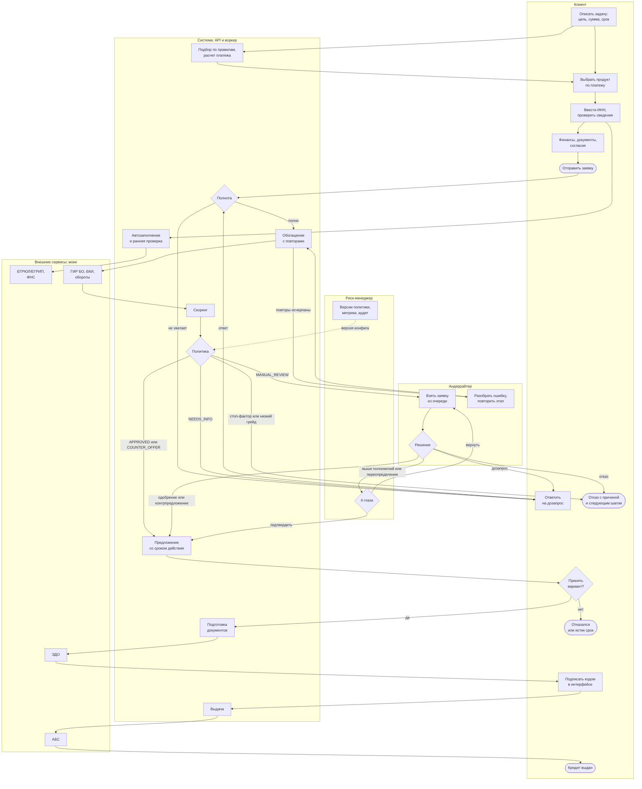
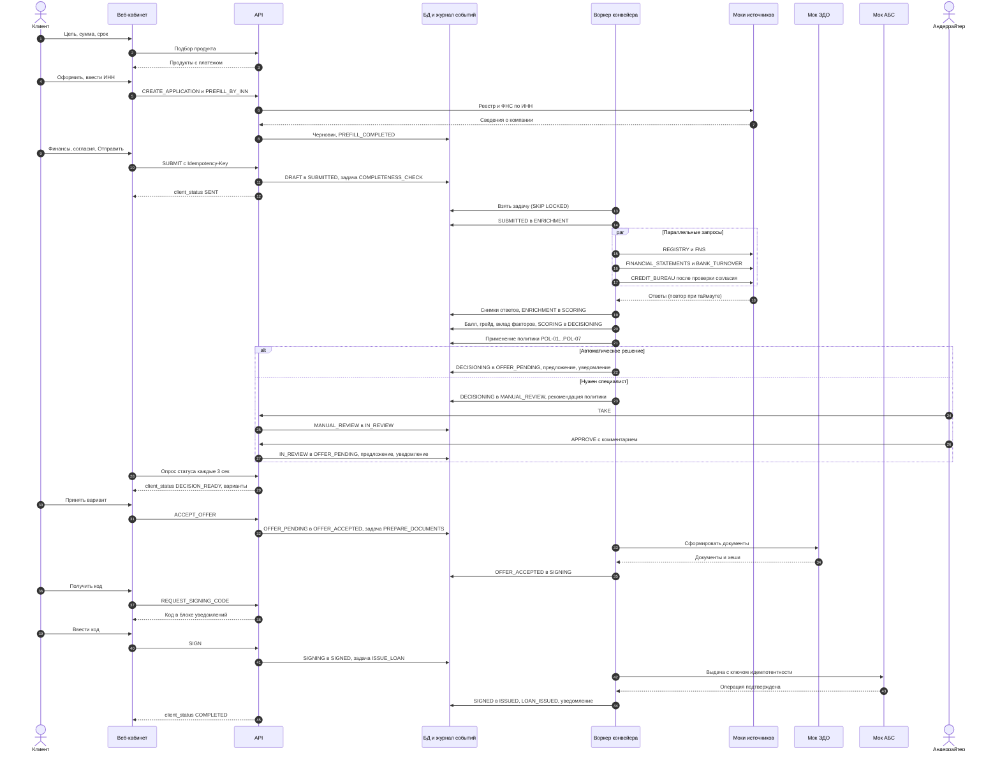
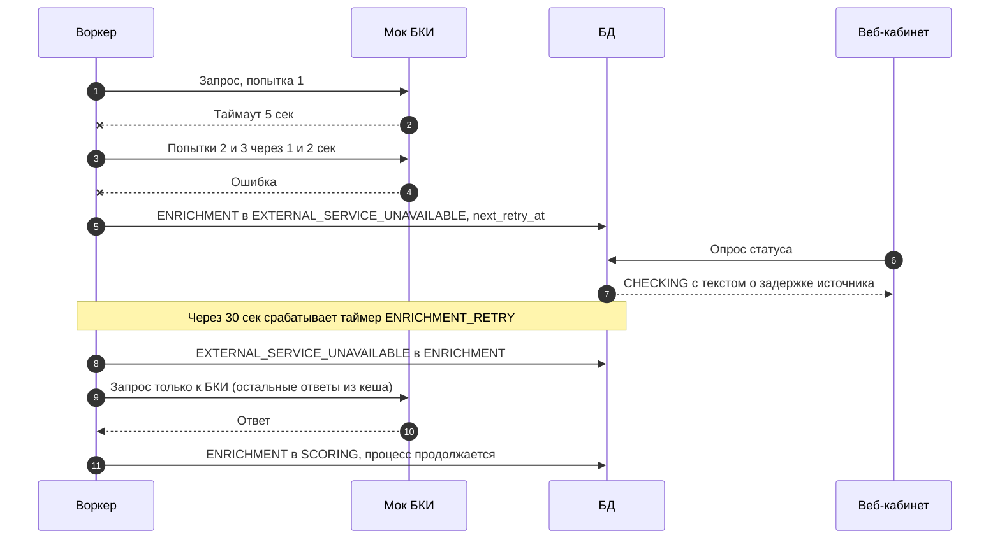

# Модель кредитного процесса

Статус: **принято для реализации MVP**. Документ отвечает на требование ТЗ "спроектируйте модель кредитного процесса: границы, этапы, действия участников, необходимые данные и возможные результаты". Статусы и переходы детализированы в [application-states.md](application-states.md), логика решения в [decision-model.md](decision-model.md), данные в [data-requirements.md](data-requirements.md).

## 1. Границы процесса

| | Что | Почему так |
|---|---|---|
| **Начало** | клиент открывает мастер подбора и описывает задачу (событие `PRODUCT_WIZARD_STARTED`); для банка заявка становится объектом обработки при отправке (`SUBMIT`, статус `SUBMITTED`) | ТЗ: путь начинается с потребности бизнеса; подбор входит в продукт, потому что клиент мыслит задачей, а не продуктом (H1) |
| **Успешный конец** | кредит выдан или лимит кредитной линии открыт в моке АБС (статус `ISSUED`) | ТЗ: "от обращения за продуктом до получения результата" |
| **Другие концы** | отказ банка (`DECLINED`), отказ клиента от предложения (`OFFER_DECLINED`), истечение предложения (`OFFER_EXPIRED`), отмена клиентом или по таймеру (`CANCELLED`) | каждый исход является понятным результатом для клиента |
| **За границей** | обслуживание кредита, погашения, транши кредитной линии, мониторинг и ковенанты, реструктуризация, оформление и регистрация залога, кредитный комитет, проверки службы безопасности сверх автоматических стоп-факторов | не входят в путь "от потребности до результата" или заменены автоматическими проверками ([../product/mvp-scope.md](../product/mvp-scope.md)) |

## 2. Участники

| Участник | Тип | Роль в процессе | В MVP |
|---|---|---|---|
| Клиент (представитель бизнеса) | человек, роль `CLIENT` | описывает задачу, выбирает продукт, заполняет заявку, дает согласия, отвечает на дозапросы, выбирает вариант, подписывает | веб-кабинет клиента |
| Система (API и воркер конвейера) | автоматический | подбор, автозаполнение, проверка полноты, оркестрация обогащения с повторами, скоринг, политика, предложения, таймеры, уведомления, аудит | `services/api`, воркер |
| Внешние сервисы | автоматические, моки | ЕГРЮЛ/ЕГРИП, ФНС "Прозрачный бизнес", ГИР БО, БКИ, внутренние обороты по счету, ЭДО (документы), АБС (выдача) | `services/integrations-mock` |
| Андеррайтер | человек, роль `UNDERWRITER` | ручное рассмотрение нестандартных заявок, дозапрос, решение, разбор ошибок обработки | рабочее место сотрудника |
| Риск-менеджер | человек, роль `RISK_MANAGER` | 4 глаза для крупных решений и переопределений, контроль метрик, версий конфигов, аудита | рабочее место сотрудника |

## 3. Этапы

| ID | Этап | Статусы | Участники | Вход | Выход и данные | Возможные результаты | SLA |
|---|---|---|---|---|---|---|---|
| ST-01 | Подбор продукта | до заявки | клиент, система | цель, сумма, срок, тип бизнеса (необязательно ИНН) | 1-3 подходящих продукта с платежом и требованиями; выбранный продукт и параметры | черновик создан (T-01); подходящего продукта нет (подсказка, как изменить запрос) | 1-2 мин клиента |
| ST-02 | Заполнение заявки | `DRAFT` | клиент, система, моки реестров | выбранный продукт и параметры; ИНН | анкета, подставленные сведения из реестров, документы, три согласия с временем; предупреждение ранней проверки | отправлена (T-03); отменена (T-04, T-05) | цель до 5 мин; черновик живет 30 дней |
| ST-03 | Прием и проверка полноты | `SUBMITTED` | система | снимок анкеты, документы | нормализованные данные, расчет запрошенного платежа | полно (T-06); не хватает данных (T-07); лимит автодозапросов исчерпан (T-08) | до 1 мин |
| ST-04 | Дозапрос | `INFO_REQUESTED` | клиент; инициатор: система или андеррайтер | список пунктов с кодами `NI_*`, сроком ответа | ответы клиента, новые документы, измененные поля с историей | ответ получен, заявка проходит конвейер заново (T-10); отмена или таймаут (T-11, T-12) | ответ клиента до 14 дней |
| ST-05 | Обогащение | `ENRICHMENT`, `EXTERNAL_SERVICE_UNAVAILABLE` | система, моки источников | ИНН, тип заявителя, согласие на БКИ | снимки ответов 5 источников с временем и номером попытки | данные получены (T-13); источник недоступен, отложенный повтор (T-14, T-15); повторы исчерпаны (T-16) | до 2 мин; при сбоях до 20 мин |
| ST-06 | Скоринг | `SCORING` | система | признаки из анкеты и источников, активная скоринговая карта | балл, грейд A-E, PD, вклад факторов, версия карты | балл рассчитан (T-17); ошибка (T-18) | до 10 сек |
| ST-07 | Кредитное решение (политика) | `DECISIONING` | система | грейд, параметры заявки и продукта, данные источников, активная политика | решение: исход, коды причин, сработавшие правила, варианты, рекомендация | `APPROVED` / `COUNTER_OFFER` (T-19); `DECLINED` (T-20); `NEEDS_INFO` (T-21); `MANUAL_REVIEW` (T-22, T-23) | до 10 сек |
| ST-08 | Ручное рассмотрение | `MANUAL_REVIEW`, `IN_REVIEW`, `PENDING_RISK_APPROVAL` | андеррайтер, риск-менеджер | карточка: анкета, источники, расхождения, скоринг, правила, рекомендация, история | ручное решение с обязательным комментарием; при 4 глазах подтверждение | одобрение или контрпредложение (T-27, T-31); дозапрос (T-29); отказ (T-30) | решение до 8 ч от входа в очередь |
| ST-09 | Предложение и выбор | `OFFER_PENDING` | клиент | предложение с 1-3 вариантами, сроком действия | выбранный вариант стал итоговыми условиями | принят (T-33); отклонен (T-34); истек (T-35) | до 7 дней |
| ST-10 | Оформление и подписание | `OFFER_ACCEPTED`, `SIGNING` | система, мок ЭДО, клиент | итоговые условия | договор, график, договоры поручительства и залога с хешами; подпись кодом из интерфейса | подписано (T-39); отказ клиента (T-38); истечение (T-40); сбой ЭДО (T-37) | документы до 1 мин; подпись до истечения предложения |
| ST-11 | Выдача | `SIGNED` | система, мок АБС | подписанные документы, итоговые условия | номер договора, счет, дата первого платежа | выдано (T-42); сбой АБС (T-43) | до 1 мин |
| ST-12 | Обработка технических ошибок | `PROCESSING_ERROR` | андеррайтер, риск-менеджер | этап сбоя, код ошибки, журнал попыток | повтор этапа | повтор (T-44); отмена клиентом до решения (T-45) | разобрать до 4 ч |

Сквозные SLA для клиента: автоматический путь от отправки до решения до 15 минут (в демо секунды); путь со специалистом до 1 рабочего дня; выдача после подписи до 1 минуты.

## 4. Схема процесса по участникам

## 5. Последовательность основного пути

Основной путь: автоматическое решение (сценарий S1); ветка `alt` показывает ручное рассмотрение (сценарий S3).

## 6. Сбой внешнего сервиса (сценарий S5)

## 7. Надежность процесса (требования, следующие из модели)

| Риск | Мера |
|---|---|
| Двойная отправка формы, повторный клик | `Idempotency-Key` на всех командах клиента и сотрудника |
| Два сотрудника меняют заявку одновременно | `expected_version` в каждой команде, условное обновление, `409 VERSION_CONFLICT` |
| Два воркера берут одну задачу | очередь в PostgreSQL, `SELECT ... FOR UPDATE SKIP LOCKED` |
| Внешний сервис недоступен | таймауты, быстрые и отложенные повторы, статус `EXTERNAL_SERVICE_UNAVAILABLE`, затем `PROCESSING_ERROR` и ручной повтор; заявка никогда не теряется |
| Двойная выдача | статус `SIGNED` как единственная точка входа в выдачу, ключ идемпотентности `application_id` в запросе к АБС |
| Изменение данных клиентом после решения | анкета неизменяема вне `DRAFT` и пунктов дозапроса; снимок при отправке |
| Решение невозможно объяснить | версии скоринговой карты и политики, `rules_fired` и коды причин в каждом решении |
| Клиент не понимает, что происходит | клиентский статус с текстами "что происходит", "что дальше", срок; уведомления в кабинете |
