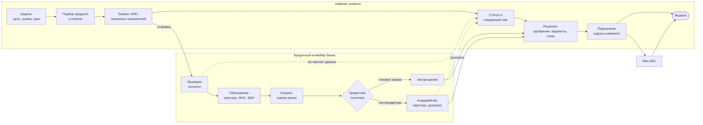

# Продукт: умный кредитный кабинет предпринимателя

## Позиционирование

**Для** владельцев и сотрудников малого и микробизнеса, которым нужны деньги на конкретную задачу, но которые не разбираются в банковских продуктах, **наш кабинет** является единым местом, где можно пройти путь от "нужны деньги на закупку" до выданного кредита. **В отличие от** анкеты на сайте и общения через менеджера, кабинет сам подбирает продукт по задаче, сам получает сведения о компании по ИНН, в каждый момент показывает статус и следующий шаг, а вместо молчаливого урезания суммы или отказа предлагает понятные варианты.

**Для банка** это кредитный конвейер, в котором типовые заявки решаются автоматически по версионируемым правилам, нестандартные попадают специалисту с полной карточкой, а каждое решение можно объяснить и воспроизвести.

## Ценность

| Для клиента | Для банка |
|---|---|
| выбирает задачу, а не продукт; сразу видит платеж и требования | меньше нецелевых заявок и возвратов по формальным ошибкам |
| вводит только цель, сумму, срок и несколько показателей, остальное подставляется по ИНН | данные источников вместо слов клиента, расхождения подсвечены |
| видит этап, срок и "что нужно от меня" без звонков в банк | меньше обращений "где моя заявка" |
| получает решение за минуты для типовых случаев | доля авторешений растет без потери контроля риска |
| при недостаточной нагрузке получает варианты (меньше сумма, дольше срок, кредитная линия), а не просто отказ | меньше потерянных клиентов при том же риске |
| понимает причину отказа и что можно сделать | объяснимость решений, аудит, версии скоринга и политики |
| подписывает и получает деньги в том же кабинете | специалисты заняты только нестандартными заявками |

## Схема продукта

## Документы

| Файл | Содержание |
|---|---|
| [mvp-scope.md](mvp-scope.md) | границы MVP: MoSCoW, RICE, что вошло и не вошло, журнал решений D-xx, неудобные вопросы жюри |
| [product-catalog.md](product-catalog.md) | 4 продукта с параметрами, цели, документы, правило подбора, калькулятор с эталонами |
| [user-stories.md](user-stories.md) | story map и истории US-xx с критериями приемки Given/When/Then |
| [screens.md](screens.md) | инвентарь экранов CL-xx и BK-xx, навигация, состояния, подсказки к терминам |
| [demo-scenarios.md](demo-scenarios.md) | 5 сценариев демо пошагово, тестовые учетные записи, требования к синтетическим профилям |
| [assumptions.md](assumptions.md) | допущения и упрощения A-xx и почему они сохраняют смысл процесса |
| [ai-usage.md](ai-usage.md) | где ИИ полезен и где нет, опциональный модуль на open-weight модели |

Процессная часть (стейт-машина, роли, модель решения, данные, события): [../process/README.md](../process/README.md). Исследование: [../research/README.md](../research/README.md).

## Ключевые коды (сквозные для всех документов)

- Продукты: `EXPRESS`, `WORKING_CAPITAL`, `CREDIT_LINE`, `INVESTMENT`.
- Роли: `CLIENT`, `UNDERWRITER`, `RISK_MANAGER`.
- Результаты решения: `APPROVED`, `COUNTER_OFFER`, `NEEDS_INFO`, `MANUAL_REVIEW`, `DECLINED`.
- Статусы заявки и клиентские статусы: [../process/application-states.md](../process/application-states.md).
- Коды причин: [../process/decision-model.md](../process/decision-model.md), раздел 9.
