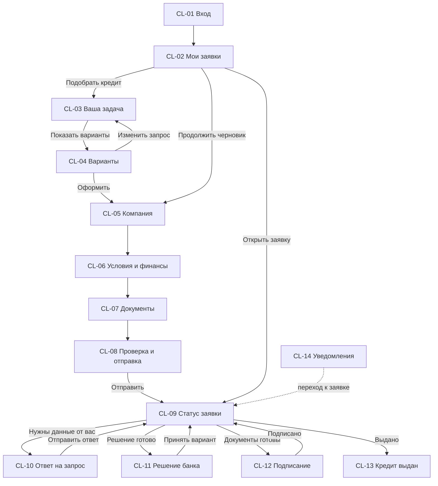
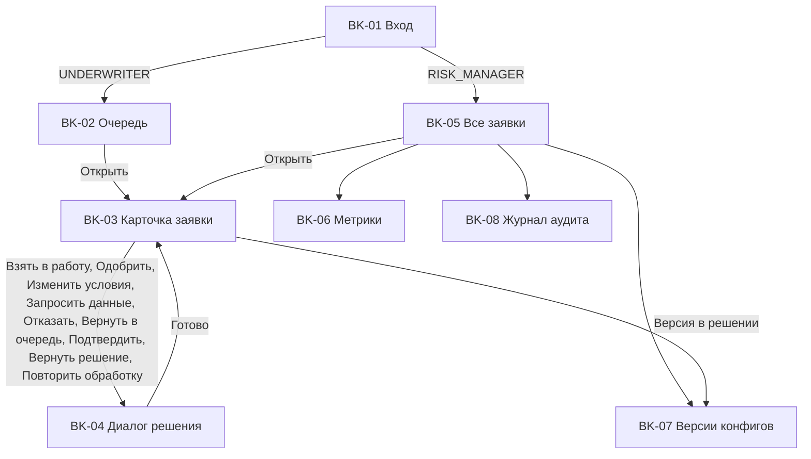

# Экраны и навигация

Статус: **принято для реализации MVP**. Главное UX-требование ТЗ: пользователь без банковской экспертизы понимает варианты, статус и следующий шаг. Поэтому у каждого экрана заявки есть три обязательных элемента: **где я** (шаг или статус), **что происходит**, **что мне делать дальше** (одна главная кнопка или "ничего не нужно, мы сообщим").

Связанные документы: [user-stories.md](user-stories.md) (критерии приемки), [../process/application-states.md](../process/application-states.md) (клиентские статусы и тексты), [../process/decision-model.md](../process/decision-model.md) (тексты причин), [product-catalog.md](product-catalog.md) (продукты, цели, документы).

## 1. Общие правила интерфейса

1. **Язык.** Без банковского жаргона; если термин неизбежен, рядом значок подсказки с текстом из раздела 5. Обращение на "вы".
2. **Числа.** Суммы с разделителем разрядов и знаком рубля: `1 200 000 ₽`; ставки `22%`; сроки "24 месяца"; даты и время конкретные: "до 24 октября, 18:00", а не "в течение 8 часов".
3. **Доступные действия.** Кнопки действий над заявкой строятся только из `available_actions` ответа API; если действия нет, кнопки нет.
4. **Обновление статуса.** Экран заявки опрашивает API каждые 3 сек, пока клиентский статус `SENT`, `CHECKING`, `DOCUMENTS` или `PAYOUT`, и каждые 15 сек в остальных нетерминальных статусах; смена статуса видна без перезагрузки.
5. **Ошибки.** Ошибка поля показывается под полем текстом из [../process/data-requirements.md](../process/data-requirements.md), раздел 1.2. Сетевая ошибка: баннер "Нет связи с сервером, повторяем..." и автоматический повтор. Конфликт версии `409 VERSION_CONFLICT`: "Заявка изменилась, мы обновили данные" и перезагрузка данных. Ответ `403`/`404`: страница "Заявка не найдена или у вас нет к ней доступа".
6. **Загрузка.** Скелетоны вместо пустых блоков; кнопка команды блокируется на время запроса, повторный клик не отправляет вторую команду.
7. **Доступность.** Все поля с подписями, управление с клавиатуры, контраст текста не ниже AA, статус не передается только цветом (иконка и текст).
8. **Веб-интерфейс**, адаптивная верстка от 360 px до десктопа (мобильное приложение не делаем по ТЗ).
9. **Уведомления** только в продукте: колокольчик в шапке с числом непрочитанных, лента CL-14, баннер на экране заявки.

## 2. Инвентарь экранов

| ID | Экран | Роли | Маршрут (рекомендация) | Приоритет |
|---|---|---|---|---|
| CL-01 / BK-01 | Вход | все | `/login` | M |
| CL-02 | Мои заявки | `CLIENT` | `/client/applications` | M |
| CL-03 | Подбор: ваша задача | `CLIENT` | `/client/wizard` | M |
| CL-04 | Подбор: подходящие варианты | `CLIENT` | `/client/wizard/results` | M |
| CL-05 | Заявка, шаг 1: компания | `CLIENT` | `/client/applications/:id/edit/company` | M |
| CL-06 | Заявка, шаг 2: условия и финансы | `CLIENT` | `/client/applications/:id/edit/terms` | M |
| CL-07 | Заявка, шаг 3: документы | `CLIENT` | `/client/applications/:id/edit/documents` | M |
| CL-08 | Заявка, шаг 4: проверка, согласия, отправка | `CLIENT` | `/client/applications/:id/edit/review` | M |
| CL-09 | Заявка: статус | `CLIENT` | `/client/applications/:id` | M |
| CL-10 | Ответ на запрос банка | `CLIENT` | `/client/applications/:id/info-request` | M |
| CL-11 | Решение банка | `CLIENT` | `/client/applications/:id/offer` | M |
| CL-12 | Подписание документов | `CLIENT` | `/client/applications/:id/signing` | M |
| CL-13 | Кредит выдан | `CLIENT` | состояние CL-09 | M |
| CL-14 | Уведомления | все | панель в шапке | M |
| BK-02 | Очередь заявок | `UNDERWRITER`, `RISK_MANAGER` | `/bank/queue` | M |
| BK-03 | Карточка заявки | `UNDERWRITER`, `RISK_MANAGER` | `/bank/applications/:id` | M |
| BK-04 | Диалоги решения | `UNDERWRITER`, `RISK_MANAGER` | модальные окна на BK-03 | M |
| BK-05 | Все заявки | `RISK_MANAGER` | `/bank/applications` | S |
| BK-06 | Метрики | `RISK_MANAGER` | `/bank/metrics` | S |
| BK-07 | Версии скоринга и политики | `RISK_MANAGER` (чтение `UNDERWRITER`) | `/bank/configs` | S |
| BK-08 | Журнал аудита и доступа | `RISK_MANAGER` | `/bank/audit` | S |

## 3. Навигация

### 3.1. Клиент

### 3.2. Сотрудник банка

## 4. Описание экранов

### CL-01 / BK-01. Вход

- **Цель:** войти под тестовой учетной записью; после входа переход по роли (`CLIENT` в CL-02, `UNDERWRITER` в BK-02, `RISK_MANAGER` в BK-05).
- **Блоки:** логин, пароль, кнопка "Войти"; подсказка "Это прототип. Тестовые учетные записи перечислены в README".
- **Ошибки:** "Неверный логин или пароль" (без уточнения, что именно неверно); после 5 неудачных попыток пауза 1 минута.

### CL-02. Мои заявки

- **Цель:** увидеть все заявки и одно следующее действие по каждой.
- **Блоки:** кнопка "Подобрать кредит"; карточки заявок: номер, продукт, сумма, клиентский статус (иконка и текст), дата изменения, кнопка следующего действия.
- **Кнопка следующего действия по `client_status`:** `FILLING` "Продолжить заполнение"; `ACTION_REQUIRED` "Ответить на запрос банка" (выделена); `DECISION_READY` "Посмотреть решение"; `DOCUMENTS` "Подписать документы"; остальные "Открыть".
- **Пустое состояние:** "У вас пока нет заявок. Расскажите, на что нужны деньги, и мы подберем подходящий кредит" и кнопка "Подобрать кредит".

### CL-03. Подбор: ваша задача

- **Цель:** описать потребность без знания продуктов (H1).
- **Блоки:** 1) "На что нужны деньги?" 8 кнопок-целей с подсказками (каталог, раздел 1); 2) "Сколько нужно?" поле с ползунком 300 000 - 100 000 000; 3) "На какой срок?" поле с ползунком 3 - 84 месяца и подсказка "Чем дольше срок, тем меньше платеж в месяц, но больше переплата"; 4) "Кто вы?" ИП или ООО (необязательно) и поле ИНН (необязательно, "чтобы сразу проверить, какие продукты вам доступны").
- **Действие:** "Показать варианты".
- **Ошибки:** цель не выбрана: "Выберите, на что нужны деньги".

### CL-04. Подбор: подходящие варианты

- **Цель:** сравнить 1-3 варианта по платежу и требованиям (H1, H12).
- **Блоки:** сводка запроса с кнопкой "Изменить"; карточки продуктов: название, "для чего", пометка "Рекомендуем", ставка от, платеж от (крупно), переплата от, срок решения, "Что понадобится", кнопка "Оформить"; калькулятор на карточке (изменение суммы и срока); подсказка о кредитной линии для целей `SEASONAL_PURCHASES` и `CASH_GAP`; неактивные карточки с причиной (ранняя проверка возраста бизнеса).
- **Текст под карточками:** "Ставка и платеж ориентировочные. Точные условия банк рассчитает после проверки заявки, обычно за несколько минут".
- **Пустое состояние:** тексты из каталога, раздел 4.3, и кнопка "Изменить запрос".

### CL-05. Заявка, шаг 1: компания

- **Цель:** определить заявителя и подтянуть сведения по ИНН (H2), рано предупредить о стоп-факторах (H3).
- **Блоки:** индикатор шагов заявки (1 из 4, "Сохранено в 14:32"); поле ИНН (маска, проверка контрольной суммы на лету); блок "Сведения из госреестров" (только чтение, источник и дата); выбор "Кем вы являетесь в компании"; предупреждение ранней проверки (желтый баннер).
- **Подсказка у ИНН:** "ИНН есть в свидетельстве о постановке на учет или в любой выписке из налоговой. У компании 10 цифр, у ИП 12".
- **Подсказка у блока сведений:** "Эти данные мы получили из госреестров сами, вводить их не нужно. Если что-то устарело, данные обновляются через налоговую".
- **Состояния:** загрузка сведений (скелетон, "Получаем сведения из госреестров..."); `INN_NOT_FOUND`; реестр недоступен ("Не удалось получить сведения, попробуем при обработке заявки. Можно продолжать").
- **Действия:** "Далее".

### CL-06. Заявка, шаг 2: условия и финансы

- **Цель:** задать параметры кредита и несколько финансовых показателей.
- **Блоки:** продукт (название, кнопка "Выбрать другой" ведет в подбор); цель, сумма, срок (предзаполнены из подбора, редактируются в границах продукта, платеж пересчитывается); "Средняя выручка в месяц за последние 12 месяцев"; "Сколько бизнес сейчас платит по кредитам и займам в месяц"; для ООО: блок поручительства с ФИО поручителя из реестра и чекбоксом; для `INVESTMENT`: блок "Залог" (тип, описание, примерная стоимость, чье имущество) и "О проекте" (описание, собственные средства); "Что еще важно знать банку" (необязательно).
- **Подсказки:** выручка: "Все поступления от продаж в среднем за месяц, до вычета расходов и налогов. Банк сверит ее с налоговой отчетностью или оборотами по счету"; текущие платежи: "Сумма ежемесячных платежей по всем кредитам, займам и лизингу бизнеса (и личным кредитам ИП). Если кредитов нет, укажите 0".
- **Ошибки и предупреждения:** `OUT_OF_RANGE`, `NOT_MULTIPLE_OF_STEP`, предупреждение "Проверьте сумму: платежи больше выручки".

### CL-07. Заявка, шаг 3: документы

- **Цель:** приложить документы, которые требует продукт.
- **Блоки:** список требуемых документов с объяснением "зачем" (каталог, раздел 2.2), область загрузки (перетаскивание или выбор), список загруженных файлов с размером и кнопкой удаления.
- **Пустое состояние для `EXPRESS` и `WORKING_CAPITAL`:** "Для этого кредита документы не нужны: сведения о бизнесе банк получит сам" и кнопка "Далее".
- **Предупреждение при отсутствии обязательных документов:** "Без этих документов рассмотрение начнется только после их загрузки. Банк попросит их в кабинете".
- **Ошибки:** `DOCUMENT_TOO_LARGE`, `DOCUMENT_TYPE_NOT_ALLOWED`, "Не удалось загрузить файл, попробуйте еще раз".

### CL-08. Заявка, шаг 4: проверка, согласия, отправка

- **Цель:** проверить заявку и осознанно дать согласия (C8).
- **Блоки:** сводка по шагам с кнопками "Изменить"; расчет "Ваш платеж будет около {P} в месяц при ставке от {r}%"; три чекбокса согласий (тексты в [../process/data-requirements.md](../process/data-requirements.md), раздел 6) со ссылками "Что это значит"; блок "Что будет дальше": "После отправки мы проверим данные в госреестрах, налоговой и бюро кредитных историй. Обычно решение готово за несколько минут, для инвестиционного кредита до 1 рабочего дня"; кнопка "Отправить заявку".
- **Ошибки:** список `422` с переходом к полю; `CONSENT_REQUIRED`; `DUPLICATE_ACTIVE_APPLICATION` со ссылкой на существующую заявку.

### CL-09. Заявка: статус

- **Цель:** в любой момент понять этап, что происходит, что дальше и сколько ждать (H4).
- **Блоки:**
  1. Прогресс из 8 шагов: Заявка, Отправлена, Проверка данных, Рассмотрение специалистом, Решение, Подписание, Выдача, Готово. Текущий шаг выделен; пропущенный шаг 4 отмечен "не потребовался".
  2. Главный блок статуса: заголовок, "Что происходит", "Что дальше", срок (тексты из таблицы 3.2 стейт-машины) и одна главная кнопка (если есть действие).
  3. Блок действия при `ACTION_REQUIRED`, `DECISION_READY`, `DOCUMENTS`: выделенная карточка с кнопкой.
  4. "Параметры заявки": продукт, сумма, срок, цель, компания.
  5. "История": смены клиентского статуса с датой и временем.
- **Состояния:** `CHECKING` с анимацией прогресса и фразой "От вас ничего не нужно"; задержка источника (текст варианта `EXTERNAL_SERVICE_UNAVAILABLE`); `REJECTED` (блок причины и следующего шага, кнопка "Подобрать другой вариант"); `WITHDRAWN`, `EXPIRED` (кнопка "Подать новую заявку", данные компании подставятся).
- **Действия:** "Отменить заявку" в статусах, где разрешен `WITHDRAW` (с подтверждением "Заявка будет закрыта, отменить это действие нельзя").

### CL-10. Ответ на запрос банка

- **Цель:** ответить на все уточнения за один раз (H5).
- **Блоки:** заголовок "Банку нужно {k} уточнений", срок ответа; список пунктов: текст для клиента (что и зачем), поле ответа по типу (`DOCUMENT` загрузка, `FIELD` поле анкеты с текущим значением, `TEXT` многострочное поле), отметка "обязательно"; кнопка "Отправить ответ" (активна, когда заполнены обязательные пункты).
- **Подсказка:** "После отправки рассмотрение продолжится автоматически. Если вопрос непонятен, опишите это в ответе, специалист увидит ваш комментарий".
- **Ошибки:** `422` по пункту; истекший срок: "Срок ответа истек, заявка закрыта".

### CL-11. Решение банка

- **Цель:** понять решение и выбрать вариант (H6, H7, C11-C13).
- **Варианты экрана:**
  - **Одобрено.** Заголовок "Заявка одобрена"; карточка условий: сумма, срок, итоговая ставка, ежемесячный платеж (крупно), переплата, обеспечение, дата окончания предложения; ссылка "График платежей"; при альтернативе кредитной линии вторая карточка с текстом `CO_PRODUCT_ALTERNATIVE`; кнопки "Принять условия", "Отказаться".
  - **Другие условия.** Блок "Вы просили" (сумма, срок, платеж); текст причины `CO_DEBT_LOAD`; 1-3 карточки вариантов: отличие от запроса выделено ("на 6 000 000 ₽ меньше", "на 18 месяцев дольше", "кредитная линия"), платеж, переплата, ставка; пометка "Рекомендуем"; выбор варианта и кнопка "Выбрать этот вариант"; "Отказаться от предложения" с необязательным выбором причины `OD_*`.
  - **Отказ.** Заголовок "Банк не может выдать кредит"; тексты причин и "Что можно сделать" из справочника; кнопки "Подобрать другой вариант" и "Вернуться к заявкам".
- **Подтверждение выбора:** окно "Вы выбираете: {вариант}. Дальше банк подготовит документы для подписания".
- **Ошибки:** предложение истекло во время просмотра: `409`, сообщение "Срок предложения истек" и переход к CL-09.

### CL-12. Подписание документов

- **Цель:** прочитать документы и подписать их в кабинете (C14).
- **Блоки:** список документов с кнопкой "Открыть" (просмотр PDF из мока ЭДО); чекбокс "Я ознакомился с документами"; кнопка "Получить код"; поле ввода 6-значного кода; таймер действия кода; кнопка "Подписать".
- **Пояснение:** "Подписание в прототипе смоделировано: код подтверждения показывается здесь, в кабинете. В реальном продукте используется электронная подпись".
- **Состояния и ошибки:** документы готовятся (`OFFER_ACCEPTED`): "Готовим документы, это займет меньше минуты"; неверный код: "Неверный код, осталось попыток: {n}"; код истек: "Код больше не действует, получите новый"; превышен лимит кодов: "Слишком много запросов кода, попробуйте через {m} минут".

### CL-13. Кредит выдан

- **Цель:** подтвердить результат и показать, что дальше.
- **Блоки:** заголовок "Кредит выдан" (или "Лимит кредитной линии открыт"); сумма, счет (маскирован), номер договора, ставка, срок; первый платеж: дата и сумма; график платежей; подписанные документы для просмотра.
- **Подсказка:** "Платежи списываются со счета автоматически в дату платежа" (в прототипе обслуживание кредита не моделируется).

### CL-14. Уведомления

- **Цель:** узнавать о событиях без email и SMS.
- **Блоки:** колокольчик со счетчиком; лента: заголовок, текст, время, ссылка на заявку; "Отметить все прочитанными".
- **Пустое состояние:** "Новых уведомлений нет".

### BK-02. Очередь заявок

- **Цель:** брать в работу заявки по сроку SLA (B-8).
- **Вкладки:** "Очередь" (`MANUAL_REVIEW`), "Мои" (`IN_REVIEW`, `PENDING_RISK_APPROVAL` своего авторства), "Ошибки обработки" (`PROCESSING_ERROR`), "Решенные мной"; для риск-менеджера также "На согласовании".
- **Колонки:** номер, компания, продукт, сумма, причины ручного рассмотрения (коды и короткие тексты для сотрудника), грейд, время в очереди, срок `review_due_at` (красный при `sla_breached`), исполнитель.
- **Действия:** "Открыть", "Взять в работу" прямо из строки.
- **Пустое состояние:** "Очередь пуста. Все заявки решены автоматически или уже в работе".

### BK-03. Карточка заявки

- **Цель:** принять обоснованное решение, не переключаясь между системами (H10).
- **Шапка:** номер, компания, ИНН, продукт, сумма, срок, внутренний статус и клиентский статус, исполнитель, срок SLA, панель действий из `available_actions`.
- **Вкладки и блоки:**
  1. "Сводка": параметры заявки; блок "Расхождения" (например, "Выручка в анкете на 35% выше данных ГИР БО"); причины ручного рассмотрения; рекомендация политики (исход, допустимый платеж, максимальная сумма на запрошенный срок, рассчитанные варианты).
  2. "Скоринг": балл, грейд, PD, таблица факторов (фактор, значение, интервал, баллы), версия карты.
  3. "Политика": сработавшие правила POL-xx с входными значениями и результатом, версия политики.
  4. "Источники": данные каждого источника с временем ответа и числом попыток.
  5. "Анкета и документы": поля анкеты, история изменений полей после дозапросов, документы клиента (скачивание журналируется), согласия с временем.
  6. "Дозапросы": все дозапросы с пунктами, ответами и временем ответа.
  7. "История": все события заявки.
  8. "Комментарии": внутренние комментарии сотрудников.
- **ИИ-резюме (Could):** кнопка "Сформировать резюме" над сводкой, результат с пометкой "Сформировано автоматически".

### BK-04. Диалоги решения

| Диалог | Поля | Правила |
|---|---|---|
| Взять в работу | подтверждение | при конфликте "Заявку уже взял {имя}" |
| Одобрить | комментарий (обязательно); показ итоговых условий и ставки из матрицы | предупреждение о 4 глазах, если сумма больше `underwriter_authority_limit` |
| Изменить условия | 1-3 варианта: продукт (исходный или `CREDIT_LINE`), сумма, срок; платеж считается на лету; комментарий (обязательно) | границы продукта; предупреждение "Это решение отличается от рекомендации политики" при переопределении |
| Запросить данные | 1-10 пунктов: код `NI_*`, тип ответа, обязательность, текст для клиента (шаблон редактируется); комментарий | предпросмотр "Так клиент увидит запрос" |
| Отказать | коды причин (мультивыбор из `SF_*`, `DCL_*`), комментарий (обязательно) | предпросмотр текста для клиента |
| Вернуть в очередь | комментарий (обязательно) | только исполнитель |
| Подтвердить / Вернуть решение (риск-менеджер) | комментарий (обязателен при возврате) | недоступно автору проекта решения |
| Повторить обработку | подтверждение, показ `failed_stage` и `last_error_code` | |

### BK-05. Все заявки

- **Цель:** поиск и контроль любой заявки (кроме черновиков).
- **Фильтры:** статус, продукт, исход решения, режим решения (авто/ручное), период, номер заявки, ИНН.
- **Пустое состояние:** "Заявок по фильтру нет".

### BK-06. Метрики

- **Цель:** видеть узкие места процесса и качество решений (B-12).
- **Блоки:** North Star и time to decision; воронка; доля авторешений; SLA ручной очереди; структура исходов; контрпредложения и их принятие; доля переопределений; ошибки интеграций и ретраи; фильтры по продукту и периоду. Формулы: [../process/events.md](../process/events.md), раздел 3.
- **Пустое состояние:** "Недостаточно данных за период. Пройдите демо-сценарии или загрузите синтетический поток".

### BK-07. Версии скоринга и политики

- **Цель:** показать управляемость решения (H8).
- **Блоки:** активные версии скоринговой карты и политики (версия, дата, автор, хеш); список прошлых версий; просмотр параметров только для чтения (продукты, пороги, матрица ставок, факторы карты).

### BK-08. Журнал аудита и доступа

- **Цель:** проверить, кто и когда работал с заявками и данными.
- **Блоки:** таблица событий с фильтрами по типу события, пользователю, заявке и периоду; отдельный фильтр "Просмотры карточек и скачивания документов".

## 5. Подсказки к терминам (тексты для клиента)

| Термин | Подсказка |
|---|---|
| Ставка | Процент в год, который бизнес платит банку за пользование деньгами. Чем ниже ставка, тем меньше переплата. |
| Ставка "от" | Минимальная ставка по продукту. Точную ставку банк назначит после проверки заявки. |
| Ежемесячный платеж | Сумма, которую нужно платить каждый месяц. В нее входят проценты и часть основного долга. Платеж одинаковый весь срок. |
| Переплата | Сколько бизнес заплатит банку сверх суммы кредита за весь срок. |
| Срок | За сколько месяцев нужно вернуть кредит. Дольше срок, меньше платеж, но больше переплата. |
| Поручительство собственника | Собственник компании обещает вернуть кредит лично, если компания не сможет. Для ИП не нужно: предприниматель и так отвечает своим имуществом. |
| Залог | Имущество, которое банк может продать, если кредит не будет возвращен. Пока кредит платится, имуществом пользуетесь вы. |
| Кредитная история | Сведения о прошлых и текущих кредитах и о том, вовремя ли по ним платили. Хранится в бюро кредитных историй. |
| Бюро кредитных историй | Организация, которая хранит кредитные истории. Банк запрашивает данные только с вашего согласия. |
| Кредитная линия | Лимит денег, из которого можно брать нужную сумму, когда нужно, гасить и брать снова. Проценты начисляются только на взятую сумму. |
| Транш | Часть денег, которую вы берете из кредитной линии. Каждый транш нужно вернуть за срок до 12 месяцев. |
| Выручка в месяц | Все поступления от продаж в среднем за месяц, до вычета расходов и налогов. |
| Текущие платежи по кредитам | Сколько бизнес уже платит каждый месяц по другим кредитам, займам и лизингу. |
| ИНН | Номер налогоплательщика. У компании 10 цифр, у ИП 12. |
| ОГРН / ОГРНИП | Регистрационный номер компании или ИП в госреестре. |
| Вид деятельности (ОКВЭД) | Чем занимается бизнес по данным госреестра. |
| Режим налогообложения | Как бизнес платит налоги: общая система, упрощенная, патент. |
| График платежей | Таблица с датами и суммами всех платежей по кредиту. |
| Код подтверждения | Одноразовый код, которым вы подтверждаете подписание документов. В прототипе показывается в кабинете. |
| Срок действия предложения | До этой даты можно принять условия банка. Потом банку нужно будет рассмотреть заявку заново. |
