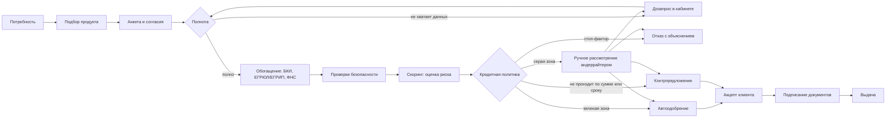

# 01. Предметная область: кредитование малого и микробизнеса

Метод: desk research по открытым источникам (октябрь 2026) и общеизвестной банковской практике. Утверждения без ссылки помечены как **[практика]**: это типовое устройство процесса, которое нужно подтвердить на интервью с сотрудниками банка (см. [05-custdev-guide.md](05-custdev-guide.md)). Все цифры по продуктам в нашем прототипе синтетические и не являются реальными условиями какого-либо банка.

## 1. Контекст рынка в цифрах

| Факт | Значение | Источник | Что следует для продукта |
|---|---|---|---|
| Субъектов МСП в реестре | 6,6 млн на 10.07.2026, +3,5% за год | ТЗ кейса | Массовый сегмент: процесс должен быть конвейером, а не ручной работой с каждой заявкой |
| Кредиты МСП, выданные банками | 1,313 трлн руб. на июль 2026 | ТЗ кейса | Поток заявок большой, ценна доля автоматических решений |
| Выдачи Альфа-Банка малому бизнесу | более 1 трлн руб. совокупно на октябрь 2025 | ТЗ кейса | Продукт должен масштабироваться по объему заявок |
| Доля отказов МСП | около 50% и выше, в отдельных отраслях до 70% (оценка Корпорации МСП) | [Inc. Russia](https://incrussia.ru/news/prichiny-otkazov-biznesu-v-kredite/) | Отказ: массовый исход. Его нужно объяснять и по возможности заменять контрпредложением |
| Официальной статистики доли отказов в РФ нет | регулятор такой показатель не публикует | [Inc. Russia](https://incrussia.ru/news/prichiny-otkazov-biznesu-v-kredite/) | Банку нужно самому считать уровень одобрения в воронке |
| Индекс RSBI, июнь 2026 | 49,6 п.; компонента "Кредиты" ослабла из-за снижения одобряемости | [АКМ / ПСБ](https://www.akm.ru/comments/indeks_rsbi_v_iyune_delovaya_aktivnost_predprinimateley_ostaetsya_slaboy/), [методика на cbr.ru](https://www.cbr.ru/develop/msp/irsbi) | В жестких условиях клиенту важнее понять, на что он реально может рассчитывать |
| Исход заявок в США (опрос ФРС, 2025) | полную сумму получили 42%, частично 36%, ничего 22% | вторичный пересказ: [Beancount](https://beancount.io/ru/blog/2026/07/20/fed-small-business-credit-survey-loan-approval-denial-rates-guide) | "Частичное одобрение" (контрпредложение) встречается почти так же часто, как полное. Решение не бинарно, как и сказано в ТЗ |
| Льготные программы | программа "1764" (оборотные до 3 лет, инвестиционные до 10 лет); с 2025 года программа ЦБ и Корпорации МСП со ставкой "ключевая минус 3,5 п.п." | [Госуслуги, обзор программ](https://privadmin.gosuslugi.ru/netcat_files/289/2193/Antikrizisnye_programmy_l_gotnogo_kreditovaniya.pdf), [Регберри](https://www.regberry.ru/news/pravitelstvo-i-centrobank-zapustili-lgotnoe-kreditovanie-biznesa) | Клиент часто не знает, подходит ли он под льготу. Подбор должен это подсказывать (в MVP как признак продукта) |

Вывод: рынок большой, одобряемость низкая и нестабильная, решения часто частичные. Главная ценность для клиента: понять свои реальные шансы и варианты быстро, а для банка: обработать поток дешево и с контролем риска.

## 2. Кредитные продукты и типовые параметры

Диапазоны ориентировочные, собраны из открытых описаний продуктов и **[практики]**; в прототипе используем синтетический каталог с похожими параметрами.

| Продукт | Задача клиента | Сумма | Срок | Обеспечение | Кому подходит | Особенности решения |
|---|---|---|---|---|---|---|
| Экспресс-кредит (беззалоговый) | быстрые деньги на любые цели бизнеса | от сотен тысяч до 5 млн (у крупных банков беззалоговые до 30 млн) | 6-36 мес (на рынке до 60 мес) | без залога; для ООО поручительство собственника | ИП и микро-ООО с историей от 6-12 мес | максимально автоматическое решение по данным из внешних источников и оборотам по счету |
| Оборотный кредит | пополнить запасы, закрыть кассовый разрыв, исполнить контракт | 1-30 млн и выше | до 36 мес | поручительство, при крупных суммах залог | торговля, услуги, подрядчики | смотрят выручку, оборачиваемость, долговую нагрузку |
| Возобновляемая кредитная линия | регулярно брать и гасить деньги под цикл бизнеса | лимит 1-30 млн | договор до 36 мес, транш до 12 мес | поручительство, залог по сумме | бизнес с сезонностью и повторяющимися закупками | решение принимается на лимит, а не на разовую сумму |
| Овердрафт | короткие разрывы на расчетном счете | ориентир до 20% оборотов по счету без залога, до 35% с залогом | договор 1-3 года, транш 30-90 дней (до 12 мес у отдельных банков) | обычно без залога | клиенты с расчетным счетом в банке | лимит считается от поступлений на счет за 3-6 мес |
| Инвестиционный кредит | купить оборудование, транспорт, недвижимость, запустить направление | от 5 млн до сотен млн | 3-10 лет | залог приобретаемого имущества, собственное участие **[практика: 10-30%]** | растущие ООО с отчетностью | почти всегда ручной анализ, кредитный комитет |
| Льготный кредит (госпрограммы) | то же, но дешевле | по правилам программы | оборот до 3 лет, инвестиции до 10 лет | часто поручительство Корпорации МСП или РГО | субъекты из реестра МСП, приоритетные отрасли | доп. проверка критериев программы, банк обязан объяснять отказ ([Право.ру](https://pravo.ru/news/209678/)) |

Источники параметров: беззалоговые кредиты Альфа-Банка от 30 тыс. до 30 млн на 12-180 мес по данным агрегатора ([Myfin](https://ru.myfin.by/bank/alfabank/kredity-dlya-biznesa/kredit-nalicnymi-onlajn-7)), ставки на региональной странице банка от 14% до 23,5% в зависимости от залога и опций ([alfabank.ru](https://alfabank.ru/sme/profits/omsk/)); овердрафт: [Точка](https://tochka.com/knowledge/kredity/cto-takoe-overdraft/), [Альфа-Банк, овердрафт](https://alfabank.ru/corporate/credit/overdraft/); льготные программы: см. раздел 1.

**Вывод для продукта.** Клиент мыслит задачей ("купить станок", "закрыть разрыв до оплаты по контракту"), а банк продуктом. Продукты различаются не названием, а логикой решения: экспресс решается автоматически, линия и овердрафт решаются на лимит, инвестиционный почти всегда идет на ручной анализ. Поэтому подбор надо строить от цели и суммы, а продукт определять как следствие (H1 в [06-hypotheses.md](06-hypotheses.md)).

## 3. Этапы процесса в банке

Типовой кредитный конвейер МСП **[практика]**, сжатый до этапов, которые видны в ТЗ.

| # | Этап | Что происходит | Кто | Авто / ручное | Типичные проблемы |
|---|---|---|---|---|---|
| 1 | Обращение и подбор | клиент выбирает продукт, сумму, срок, цель | клиент, клиентский менеджер | авто (веб) или менеджер | клиент выбирает не тот продукт, не понимает условий |
| 2 | Анкета и согласия | реквизиты, финансовые показатели, согласие на запрос в БКИ и обработку ПДн | клиент или уполномоченный сотрудник | ручной ввод | повторный ввод того, что есть в госреестрах |
| 3 | Прием и проверка полноты | формат-контроль, обязательные поля, дубли, полномочия подписанта | система, мидл-офис | авто | возвраты из-за мелких ошибок |
| 4 | Дозапрос | запрос недостающих данных и документов | андеррайтер, клиентский менеджер | ручное | дозапрос размытый, идет звонками и почтой, несколько циклов |
| 5 | Обогащение | БКИ, ЕГРЮЛ/ЕГРИП, ФНС "Прозрачный бизнес", ГИР БО, обороты по счетам, внутренние данные | система | авто | внешние источники отвечают с задержкой или ошибкой |
| 6 | Проверки безопасности и комплаенса | ПОД/ФТ, платформа ЦБ "Знай своего клиента", списки, признаки фиктивности | служба безопасности, комплаенс | авто + ручное по сработкам | долгое ручное согласование |
| 7 | Скоринг / рейтинг | оценка риска заемщика | система, риск-методология | авто | непрозрачность для андеррайтера |
| 8 | Кредитное решение | применение кредитной политики: стоп-факторы, лимиты, матрица условий, полномочия | система, андеррайтер, кредитный комитет | авто для простых, ручное для серой зоны | непредсказуемые сроки ручного рассмотрения |
| 9 | Предложение и акцепт | клиент видит условия и соглашается или отказывается | клиент | ручное | клиент не понимает отличий контрпредложения |
| 10 | Документы и подписание | договор, поручительство, залог; подпись ЭП | клиент, юрист, мидл-офис | авто для типовых | выезд в офис, бумага |
| 11 | Выдача | постановка лимита или перечисление в АБС | бэк-офис | авто | ожидание после подписания |
| 12 | Сопровождение | мониторинг, ковенанты, ранние сигналы | риск-менеджмент | авто | за рамками MVP |

## 4. Участники процесса

| Роль | Ответственность | Что ему нужно от системы | В MVP |
|---|---|---|---|
| Клиент: собственник, директор, финдиректор, бухгалтер, уполномоченный сотрудник | подать заявку, ответить на дозапрос, принять условия, подписать | понятные варианты, статус, следующий шаг | да |
| Клиентский менеджер | ведет клиента, помогает собрать пакет | видеть статус заявки и что тормозит | нет (его функции заменяет кабинет) |
| Кредитный аналитик / андеррайтер | анализ нестандартных заявок, решение в рамках полномочий, дозапрос | единая карточка заявки, объяснимый скоринг, расхождения данных | да |
| Риск-менеджер (методология) | скоринговая модель, кредитная политика, лимиты, мониторинг качества портфеля | версии политики, метрики одобрения и риска | да (как администратор политики и метрик) |
| Служба безопасности и комплаенс | проверка на фиктивность, ПОД/ФТ, санкционные списки | сработки и основания | частично: как автоматические стоп-факторы |
| Кредитный комитет | решения сверх полномочий андеррайтера | пакет по заявке | нет (упоминаем как уровень полномочий) |
| Юрист, мидл- и бэк-офис | договоры, залоги, постановка на учет, выдача | шаблоны, интеграция с АБС | смоделировано моками ЭДО и АБС |

## 5. Источники данных

| Источник | Что дает | Для чего в решении | В MVP |
|---|---|---|---|
| Анкета клиента | цель, сумма, срок, выручка, расходы, текущие обязательства, контакты внутри кабинета | параметры заявки, самооценка финансов | да |
| ЕГРЮЛ / ЕГРИП ([egrul.nalog.ru](https://egrul.nalog.ru/)) | статус (действует, ликвидация, банкротство), дата регистрации, ОКВЭД, руководитель, учредители, адрес, признаки недостоверности | стоп-факторы, возраст бизнеса, автозаполнение анкеты | мок |
| ФНС "Прозрачный бизнес" ([pb.nalog.ru](https://pb.nalog.ru/)) | налоговый режим, среднесписочная численность, уплаченные налоги, наличие недоимки, массовость адреса и руководителя, дисквалификация, реестр МСП | стоп-факторы и факторы скоринга, косвенная оценка масштаба | мок |
| ГИР БО ([bo.nalog.ru](https://bo.nalog.ru/), [ФНС о ресурсе](https://www.nalog.gov.ru/rn25/news/activities_fts/9154566/)) | годовая бухгалтерская отчетность организаций, бесплатно и открыто с 2020 года | выручка, прибыль, долг, чистые активы для ООО | мок (у ИП отчетности нет, нужны обороты) |
| Бюро кредитных историй | действующие и закрытые обязательства, просрочки, долговая нагрузка, число запросов | платежная дисциплина, лимит по нагрузке | мок, только после согласия |
| Обороты по расчетным счетам (внутренние данные банка) | поступления и списания по месяцам | реальная выручка для ИП и микробизнеса, лимит овердрафта | мок как "внутренний источник" |
| Платформа ЦБ "Знай своего клиента" | группа риска клиента по подозрительным операциям: зеленая, желтая, красная ([Контур](https://focus.kontur.ru/site/news/54216-znaj_svoego_klienta_ot_centrobanka)) | комплаенс-стоп-фактор | вне MVP или как поле мока |
| Картотека арбитражных дел, ФССП | суды и исполнительные производства | негативные факторы | вне MVP |

**Вывод для продукта.** Большую часть "анкетных" сведений о компании банк может получить сам по ИНН. Клиент должен вводить только то, чего нет в источниках: цель, сумму, срок и несколько финансовых показателей. Это прямой ответ на требование ТЗ "сокращать повторный ввод информации" (H2).

## 6. Стоп-факторы и причины отказов

Причины отказов, которые называют Корпорация МСП и отраслевые обзоры: малый срок работы бизнеса (одобряют чаще после 6 мес работы), налоговая задолженность, просрочки в кредитной истории, нестабильное финансовое положение, высокая долговая нагрузка, много арбитражных дел и исполнительных производств, а также заниженная в отчетности прибыль, из-за которой банк недооценивает бизнес ([Inc. Russia](https://incrussia.ru/news/prichiny-otkazov-biznesu-v-kredite/), [vc.ru](https://vc.ru/money/739303-samye-chastye-prichiny-otkazov-v-kreditah-dlya-malogo-biznesa)). Отдельно: более половины предпринимателей, по опросу в пересказе [Право.ру](https://pravo.ru/news/221188/), не смогли получить господдержку, то есть льготные программы тоже не гарантируют финансирование.

Разделим их на жесткие стоп-факторы (отказ независимо от скоринга) и факторы риска (влияют на балл и условия). Пороговые значения ниже являются нашими допущениями для синтетической политики.

| Признак | Тип | Источник | Допущение для MVP |
|---|---|---|---|
| Статус "ликвидация", "банкротство", "реорганизация" | стоп-фактор | ЕГРЮЛ / ЕГРИП | отказ |
| Возраст бизнеса меньше порога | стоп-фактор для продукта | ЕГРЮЛ / ЕГРИП | меньше 6 мес: отказ по экспресс-кредиту, предложить альтернативы |
| Недостоверность сведений, массовый адрес или руководитель, дисквалификация | стоп-фактор | ФНС | отказ |
| Текущая просрочка | стоп-фактор | БКИ | просрочка больше 30 дней сейчас: отказ |
| Налоговая недоимка | стоп-фактор или ручное рассмотрение | ФНС | выше порога: отказ, ниже: ручное рассмотрение |
| Красная зона ЗСК, санкционные списки | стоп-фактор | ЦБ, списки | отказ без детализации причины клиенту |
| Исторические просрочки, число запросов в БКИ | фактор скоринга | БКИ | снижает балл |
| Долговая нагрузка (платеж / доход) | фактор скоринга и ограничение лимита | анкета, БКИ, обороты | влияет на максимальную сумму |
| Динамика выручки, рентабельность, отрасль | факторы скоринга | ГИР БО, обороты, ОКВЭД | влияет на балл |
| Расхождение анкеты и внешних данных | триггер ручного рассмотрения | сравнение | выручка в анкете больше данных источников на 30% и более: андеррайтер |

**Вывод для продукта.** Половину стоп-факторов можно проверить по ИНН до того, как клиент потратит время на анкету. Значит, ранний предварительный чек (H3) экономит время обеим сторонам. А факторы риска определяют не "да/нет", а размер суммы, поэтому политика должна уметь выдавать контрпредложение (H6).

## 7. Скоринг и кредитное решение: в чем разница

Это ключевое различие из ТЗ. Скоринг отвечает на вопрос "насколько рискован заемщик", кредитная политика отвечает на вопрос "что мы ему предложим".

| | Скоринг | Кредитное решение |
|---|---|---|
| Вопрос | Какова вероятность, что заемщик не вернет долг? | Выдавать ли, сколько, на какой срок, какой продукт, на каких условиях? |
| Вход | признаки заемщика: история, финансы, нагрузка, отрасль, возраст бизнеса | балл / риск-грейд + параметры заявки + стоп-факторы + лимиты продукта + полномочия |
| Выход | балл и риск-грейд (например A-E), вклад факторов | одобрение, контрпредложение, дозапрос, ручное рассмотрение, отказ; ставка и лимит |
| Кто владеет | риск-методология (модель) | кредитная политика банка, андеррайтер, комитет |
| Как меняется | редко, с валидацией модели на данных | чаще: аппетит к риску, лимиты, ставки, промо-программы |
| Формат в нашем решении | балльная карта, версионируемый конфиг | правила политики, отдельный версионируемый конфиг |

Пример (синтетический), почему один и тот же балл дает разные решения:

| Заявка одного клиента с риск-грейдом B | Что срабатывает в политике | Решение |
|---|---|---|
| Экспресс-кредит 3 млн на 24 мес | грейд B допустим, нагрузка в норме, сумма в пределах авто-полномочий | автоодобрение |
| Оборотный кредит 15 млн на 12 мес | платеж превышает допустимую долю дохода | контрпредложение: 9 млн на 36 мес или кредитная линия |
| Инвестиционный кредит 40 млн без залога | сумма выше авто-полномочий, требуется залог | дозапрос сведений о залоге и ручное рассмотрение |

Внутренние рейтинговые модели банки проверяют на различающую способность, точность и стабильность (так и сказано в ТЗ), поэтому в метриках качества риска ([07-metrics.md](07-metrics.md)) мы закладываем Gini и стабильность распределения баллов.

## 8. Регуляторный контекст (на уровне здравого смысла)

Это не юридическое заключение, а список ограничений, которые продукт обязан учитывать.

- **Согласие на запрос кредитной истории (218-ФЗ "О кредитных историях").** Без согласия субъекта запрашивать кредитный отчет нельзя. Согласие можно оформить электронно с простой ЭП, в нем указываются цель, дата и пользователь кредитной истории; ЦБ рекомендует оформлять его отдельной отметкой, а не прятать в тексте заявления ([разъяснение ЦБ](https://www.cbr.ru/Crosscut/LawActs/File/5821), [КонсультантПлюс](https://www.consultant.ru/document/cons_doc_LAW_200483/b004fed0b70d0f223e4a81f8ad6cd92af90a7e3b/)). Согласие действует ограниченное время (по общеизвестной норме 6 месяцев, сверить с актуальной редакцией). **Для продукта:** отдельный чекбокс с датой, хранение факта согласия в аудите, запрос в БКИ только после него.
- **Персональные данные (152-ФЗ).** ИП, директор, учредители, поручители: это физлица. Нужны цель обработки, согласие, минимизация, хранение баз ПДн граждан РФ на территории РФ, журнал доступа. **Для продукта:** ролевой доступ, аудит просмотров карточки, маскирование паспортных данных, в демо только синтетика.
- **Банковская тайна.** Сведения о счетах и операциях клиента видят только сотрудники с основанием. **Для продукта:** андеррайтер видит заявки своей очереди, действия журналируются.
- **ПОД/ФТ (115-ФЗ) и платформа ЗСК.** Банк обязан идентифицировать клиента и представителя, проверить полномочия; группа риска ЗСК является вспомогательной информацией, окончательную оценку банк делает сам ([Т-Ж](https://t-j.ru/news/platforma-znai-klienta/)). **Для продукта:** причины комплаенс-отказа клиенту не раскрываются в деталях.
- **Электронная подпись (63-ФЗ).** Договоры можно подписывать ПЭП или УКЭП в зависимости от продукта и суммы. **Для продукта:** подписание моделируется кодом подтверждения внутри интерфейса (ТЗ запрещает SMS и почту).
- **Объяснение отказа.** По льготным программам банки обязывают объяснять отказ ([Право.ру](https://pravo.ru/news/209678/)). **Для продукта:** решение всегда сопровождается понятной клиенту причиной в допустимой детализации.
- **Резервы и качество ссуд (положения ЦБ о формировании резервов).** Для МСП банки часто используют портфели однородных ссуд. **Для продукта:** вне MVP, но риск-грейд и сумма сохраняются, чтобы это можно было достроить.

## 9. Что это значит для продукта

1. Подбор должен идти от задачи клиента, а продукт определяться системой (раздел 2).
2. Данные о компании подтягиваются по ИНН, клиент вводит минимум (раздел 5).
3. Ранняя проверка стоп-факторов экономит время обеих сторон (раздел 6).
4. Скоринг и политика разделены и конфигурируемы, решение небинарно (раздел 7).
5. Согласия, аудит и роли закладываются в модель данных с первого дня (раздел 8).
6. Ручная очередь нужна только для серой зоны и крупных сумм (разделы 3, 6).
