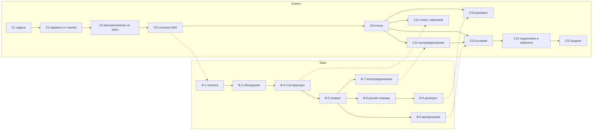

# 03. Jobs to be Done

Формат: "Когда ..., я хочу ..., чтобы ...". Job stories выведены из прото-персон ([02-personas.md](02-personas.md)) и desk research ([01-domain.md](01-domain.md)), их нужно проверить на интервью.

Колонка **MVP**: **Must** (без этого нет сквозного пути из ТЗ или главной ценности), **Should** (сильно повышает ценность, делаем при наличии времени), **Later** (за рамками MVP). Колонка **Гипотеза** ссылается на [06-hypotheses.md](06-hypotheses.md).

## Главная работа

**Клиент.** Когда бизнесу нужны деньги на конкретную задачу, я хочу быстро понять, на что могу рассчитывать, и получить деньги без хождения по банку, чтобы не упустить возможность и не рисковать бизнесом лишней долговой нагрузкой.

**Банк.** Когда приходит поток заявок МСП с разным риском, я хочу автоматически решать простые случаи и концентрировать экспертов на сложных, чтобы выдавать больше в рамках аппетита к риску при предсказуемых сроках.

## Клиент: job stories по этапам пути

| ID | Этап | Job story | Персоны | MVP | Гипотеза |
|---|---|---|---|---|---|
| C1 | Потребность | Когда я понимаю, что мне нужны деньги на конкретную задачу (закупка, оборудование, разрыв), я хочу описать ее своими словами (цель, сумма, когда верну), чтобы мне подобрали подходящий вариант без знания банковских терминов | P1, P2, P5 | Must | H1 |
| C2 | Подбор | Когда мне предлагают несколько продуктов, я хочу увидеть ежемесячный платеж, срок и что потребуется (залог, поручительство), чтобы выбрать вариант, который бизнес потянет | P1, P2, P3 | Must | H1, H12 |
| C3 | Подбор | Когда я сомневаюсь, дадут ли мне вообще, я хочу заранее узнать о явных препятствиях, чтобы не тратить время на заявку без шансов | P1, P5 | Should | H3 |
| C4 | Подбор | Когда существуют льготные программы, я хочу знать, подхожу ли я под них, чтобы не переплачивать | P3 | Later (как признак продукта в каталоге) | |
| C5 | Заявка | Когда я заполняю заявку, я хочу, чтобы сведения о компании подтянулись по ИНН, чтобы не вводить то, что банк и так может узнать | P1-P4 | Must | H2 |
| C6 | Заявка | Когда меня прервали посреди заполнения, я хочу вернуться к черновику с того же места, чтобы не начинать заново | P1, P4 | Must | H11 |
| C7 | Заявка | Когда я заполняю заявку за руководителя, я хочу видеть, какие шаги должен сделать он (согласия, подпись), чтобы правильно распределить работу | P4 | Later (в MVP подписывает сам пользователь кабинета) | H11 |
| C8 | Заявка | Когда банк просит согласие на запрос кредитной истории, я хочу понимать, зачем и что именно банк увидит, чтобы дать согласие осознанно | P1, P3 | Must | |
| C9 | Ожидание | Когда заявка отправлена, я хочу видеть, на каком она этапе, сколько еще ждать и нужно ли что-то от меня, чтобы планировать закупку и не звонить в банк | P1-P4 | Must | H4 |
| C10 | Дозапрос | Когда банку не хватает данных, я хочу получить конкретный список (что, зачем, в каком виде) и ответить в одном месте, чтобы пройти дозапрос за один раз | P3, P2 | Must | H5 |
| C11 | Решение | Когда банк одобрил меньше, чем я просил, я хочу понять почему и увидеть альтернативы (другой срок, продукт), чтобы выбрать лучший доступный вариант | P2 | Must | H6 |
| C12 | Решение | Когда мне отказали, я хочу узнать причину в понятной форме и что можно сделать, чтобы не повторять ошибку и вернуться позже | P5 | Must | H7 |
| C13 | Решение | Когда мне сделали предложение, я хочу видеть все существенные условия (ставка, график, полная стоимость, обеспечение) и иметь время подумать, чтобы не подписать вслепую | P2, P3 | Must | H12 |
| C14 | Оформление | Когда я согласен с условиями, я хочу подписать документы прямо в кабинете, чтобы не ехать в офис | P1-P3 | Must (подписание смоделировано кодом в интерфейсе) | |
| C15 | Выдача | Когда документы подписаны, я хочу видеть, когда деньги поступят или лимит станет доступен, чтобы запланировать платежи поставщикам | P1-P3 | Must (выдача смоделирована) | H4 |
| C16 | Любой | Когда мне непонятен термин или условие, я хочу получить объяснение простыми словами прямо на экране, чтобы не искать в интернете | P1, P5 | Should (подсказки-шаблоны), ИИ опционально | H13 |

## Банк: job stories по этапам обработки

| ID | Этап | Job story | Роль | MVP | Гипотеза |
|---|---|---|---|---|---|
| B-1 | Прием | Когда приходит заявка, я хочу автоматически проверить полноту и корректность, чтобы аналитики не тратили время на возвраты по формальным ошибкам | система, B1 | Must | H5 |
| B-2 | Обогащение | Когда заявка полная, я хочу автоматически получить данные из БКИ, ЕГРЮЛ/ЕГРИП и ФНС, чтобы решение опиралось на проверенные факты, а не только на слова клиента | система | Must | H2 |
| B-3 | Обогащение | Когда внешний источник недоступен или отвечает с ошибкой, я хочу, чтобы система повторила запрос и не потеряла заявку, чтобы клиент не страдал от сбоев интеграций | система | Must (надежность из ТЗ) | |
| B-4 | Проверки | Когда срабатывает стоп-фактор, я хочу сразу завершить рассмотрение с кодом причины, чтобы не тратить ресурсы и быстро ответить клиенту | система | Must | H7, H9 |
| B-5 | Скоринг | Когда рассчитан балл, я хочу видеть вклад каждого фактора, чтобы понимать и объяснять результат | B1, B2 | Must | H10 |
| B-6 | Решение | Когда заявка в зеленой зоне и в пределах авто-полномочий, я хочу принять решение без участия человека, чтобы клиент получил ответ за минуты | система, B2 | Must | H9 |
| B-7 | Решение | Когда запрошенная сумма не проходит по нагрузке, я хочу автоматически рассчитать допустимые условия и предложить их, чтобы не терять клиента отказом | система, B2 | Must | H6 |
| B-8 | Ручное рассмотрение | Когда заявка попала в серую зону, я хочу видеть ее в очереди с приоритетом по сроку и всеми данными в одной карточке, чтобы принять решение быстро и обоснованно | B1 | Must | H10 |
| B-9 | Ручное рассмотрение | Когда мне не хватает информации, я хочу отправить клиенту структурированный дозапрос из карточки, чтобы не ходить через менеджера и почту | B1 | Must | H5 |
| B-10 | Ручное рассмотрение | Когда я принимаю решение вопреки рекомендации системы, я хочу зафиксировать обоснование, чтобы решение было проверяемым | B1, B2 | Must (аудит) | H8 |
| B-11 | Политика | Когда меняется аппетит к риску, я хочу поменять пороги и лимиты в версии политики без релиза, чтобы быстро реагировать на рынок | B2 | Should (конфиг в репозитории, без UI-редактора) | H8 |
| B-12 | Контроль | Когда я управляю направлением, я хочу видеть воронку, долю авторешений, SLA и уровень одобрения, чтобы находить узкие места | B2 | Should | H8, [07-metrics.md](07-metrics.md) |
| B-13 | Контроль | Когда я разбираю инцидент или проверку, я хочу видеть полную историю заявки (кто, что, когда, на основании чего), чтобы подтвердить корректность процесса | B2 | Must (аудит) | |
| B-14 | Ручное рассмотрение | Когда заявка длинная, я хочу получить краткое резюме рисков, чтобы быстрее войти в контекст | B1 | Later (ИИ опционально) | H14 |

## Карта: какие job stories покрывает сквозной путь MVP

## Итог

- **Must для клиента:** C1, C2, C5, C6, C8, C9, C10, C11, C12, C13, C14, C15.
- **Must для банка:** B-1...B-10, B-13.
- **Should:** C3, C16, B-11, B-12.
- **Later:** C4, C7, B-14.
