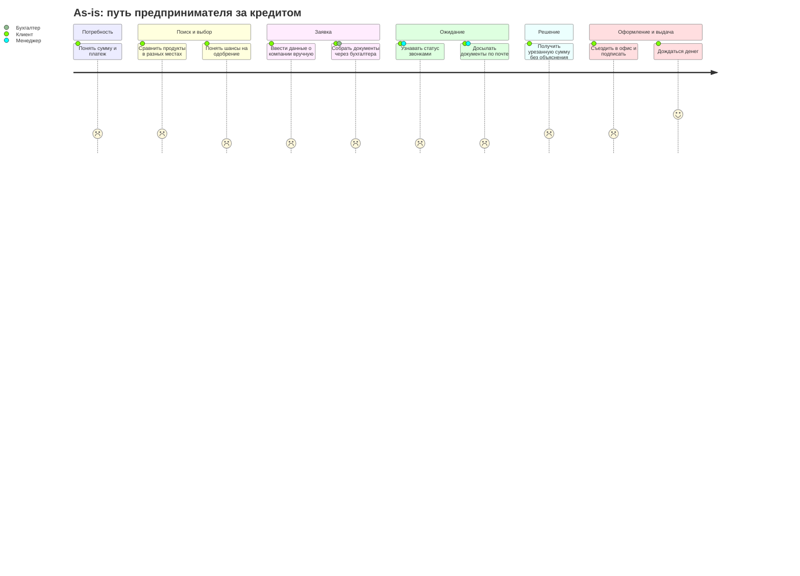
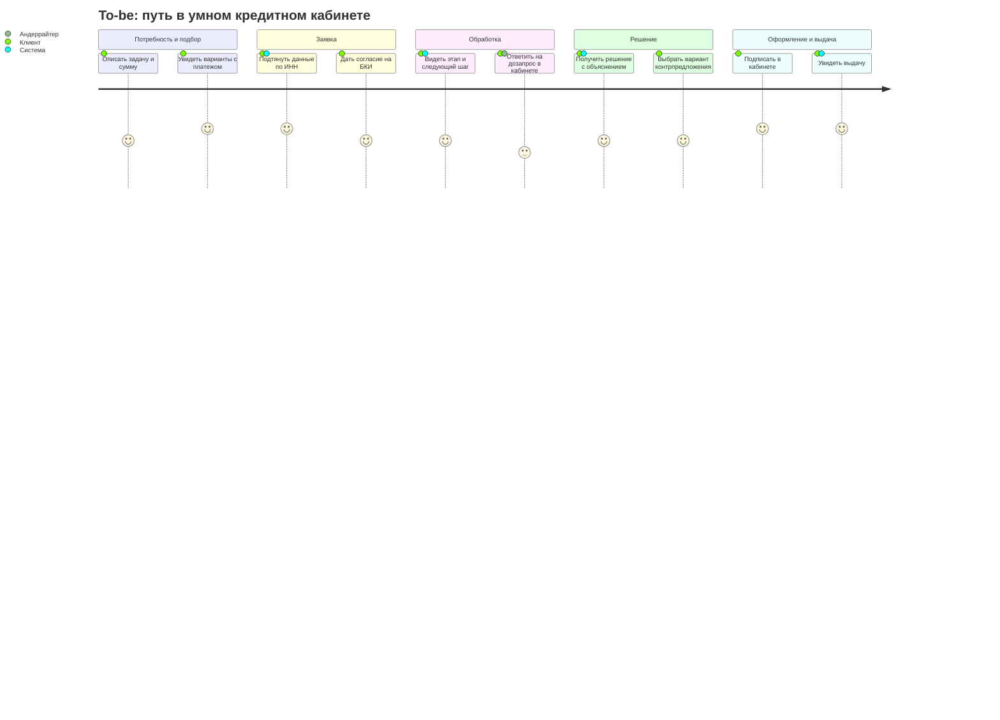
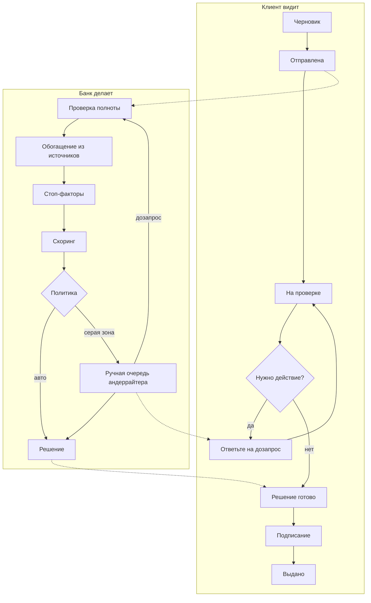

# 04. Customer Journey Map: as-is и to-be

Основа: прото-персоны P1-P3 ([02-personas.md](02-personas.md)) и desk research ([01-domain.md](01-domain.md)). Эмоции и длительности as-is являются **гипотезами**, их нужно проверить на интервью (вопросы блока 3 в [05-custdev-guide.md](05-custdev-guide.md)). Эмоция по шкале от -2 (сильный негатив) до +2.

## 1. As-is: как клиент проходит путь сейчас

| | 1. Потребность | 2. Поиск и выбор | 3. Заявка и документы | 4. Ожидание и дозапросы | 5. Решение | 6. Оформление | 7. Выдача |
|---|---|---|---|---|---|---|---|
| **Действия** | понимает, что не хватает денег; прикидывает сумму | смотрит сайты банков, агрегаторы, спрашивает знакомых, звонит менеджеру | заполняет анкету, просит бухгалтера выгрузки, сканирует документы | ждет, отвечает на звонки, досылает документы | получает ответ по телефону или в письме | едет в офис или подписывает ЭП, подписывает поручительство | ждет зачисления |
| **Каналы** | собственная таблица, выписка | сайты, агрегаторы, телефон | веб-форма, почта, мессенджер менеджера | телефон, почта | телефон, почта | офис, ЭДО | интернет-банк |
| **Мысли и вопросы** | "Сколько мне на самом деле нужно?" | "Какой продукт мой? Дадут ли мне?" | "Зачем им это, если есть в налоговой?" | "Где моя заявка? Сколько еще ждать?" | "Почему меньше? Почему отказ?" | "Что я подписываю?" | "Когда деньги будут на счете?" |
| **Эмоция** | -1 | -1 | -2 | -2 | -1 (одобрение +1, отказ -2) | 0 | +1 |
| **Боли** | нет ориентира по сумме и платежу | термины, условия "от", нет понимания шансов | повторный ввод, сбор документов через третьих лиц | непрозрачный статус, дозапросы по частям в разных каналах | отказ или урезание без объяснения | поездки, бумага | неясный срок зачисления |
| **Длительность [гипотеза]** | часы | 1-3 дня | 1-3 дня | от 1 дня до 2 недель | | 1-3 дня | до 1 дня |
| **Возможности** | расчет платежа от задачи | подбор от цели, ранний чек стоп-факторов | автозаполнение по ИНН | статус и дозапрос в кабинете | контрпредложение и объяснение | подписание в кабинете | статус выдачи |

**Главные провалы as-is:** этапы 3 и 4 (повторный ввод и непрозрачное ожидание) и момент решения, когда клиент не понимает, почему результат такой.

## 2. Backstage банка as-is

| | 1. Потребность | 2. Поиск и выбор | 3. Заявка и документы | 4. Ожидание и дозапросы | 5. Решение | 6. Оформление | 7. Выдача |
|---|---|---|---|---|---|---|---|
| **Кто работает** | маркетинг | клиентский менеджер | мидл-офис | андеррайтер, служба безопасности | андеррайтер, комитет | юрист, мидл-офис | бэк-офис, АБС |
| **Что делает** | | консультирует по телефону | проверяет комплектность вручную | запрашивает БКИ и реестры, сверяет с анкетой, просит документы через менеджера | применяет политику, оформляет заключение | готовит договоры | ставит лимит, перечисляет |
| **Боли банка** | | дорогой ручной канал консультаций | возвраты по формальным ошибкам | данные в разных системах, дозапрос через посредника, нет единой очереди | непрозрачные критерии для клиента, вручную считает допустимую сумму | шаблоны вне системы | ожидание подписанных документов |

## 3. To-be: путь в нашем продукте

Ограничения ТЗ учтены: весь путь в веб-кабинете, уведомления и коды подтверждения только внутри интерфейса, подписание и выдача смоделированы.

| | 1. Потребность | 2. Подбор | 3. Заявка | 4. Обработка и дозапрос | 5. Решение | 6. Оформление | 7. Выдача |
|---|---|---|---|---|---|---|---|
| **Действия клиента** | указывает цель, сумму, желаемый срок | видит 1-3 подходящих продукта с платежом и требованиями | вводит ИНН, проверяет подтянутые данные, добавляет 3-5 финансовых показателей, дает согласие на БКИ | видит таймлайн статуса; при дозапросе отвечает в кабинете | видит одобрение, контрпредложение рядом с исходным запросом или отказ с причиной и следующим шагом | принимает условия, подписывает кодом из интерфейса | видит статус "выдано" и параметры кредита |
| **Функции продукта** | мастер подбора от задачи (H1) | калькулятор платежа (H12), ранний чек (H3, Should) | автозаполнение по ИНН (H2), автосохранение черновика (H11), отдельное согласие | статус с "следующим шагом" и ожидаемым временем (H4), структурированный дозапрос (H5) | контрпредложение (H6), объяснимый отказ (H7) | смоделированное подписание | смоделированная выдача через мок АБС |
| **Эмоция [цель]** | 0 | +1 | +1 | 0 | +1 (отказ: -1 вместо -2) | +1 | +2 |
| **Длительность [цель для демо]** | 1 мин | 1-2 мин | 3-5 мин | автоматически: секунды; ручное: в пределах SLA | сразу после рассмотрения | 1 мин | секунды |
| **Метрика этапа** | старт подбора | конверсия подбор → заявка | время заполнения, доля автозаполненных полей | время до решения, число циклов дозапроса | доля принятых контрпредложений | конверсия предложение → подпись | конверсия подпись → выдача |

## 4. Backstage банка to-be

| | 3. Заявка | 4. Обработка и дозапрос | 5. Решение | 6-7. Оформление и выдача |
|---|---|---|---|---|
| **Система** | проверка полноты и формата, фиксация согласия в аудите | воркер конвейера: запросы в моки БКИ, ЕГРЮЛ/ЕГРИП, ФНС с ретраями и таймаутами; проверка стоп-факторов; скоринг по балльной карте | политика: авторешение, контрпредложение по лимиту нагрузки, маршрутизация в ручную очередь | генерация документов, мок ЭДО, мок АБС |
| **Андеррайтер (B1)** | | очередь серой зоны с SLA; карточка с данными, расхождениями, вкладом факторов; дозапрос из шаблона | одобрить, изменить условия, отказать с кодом причины и комментарием | |
| **Риск-менеджер (B2)** | | | версия скоринговой карты и политики фиксируется в решении | метрики воронки и качества |
| **Что убрали** | ручную проверку комплектности | посредника в дозапросе, переключение между системами | ручной расчет допустимой суммы | бумагу и поездки |

Клиентские статусы намеренно крупнее внутренних: клиент видит 6-8 понятных шагов, банк работает с детальными состояниями. Детальную стейт-машину проектирует PM-2 в `docs/process/`.

## 5. Выводы из CJM

1. Наибольший выигрыш дают этапы 3 и 4: автозаполнение и прозрачный статус снимают две самые негативные точки (эмоция -2).
2. Момент решения должен объяснять результат. Небинарное решение (контрпредложение) превращает "урезали без объяснений" в выбор клиента.
3. Для банка ключевое изменение: единая карточка и дозапрос без посредника. Это сокращает ручное время и количество циклов.
4. Клиентский статус должен отражать "что от меня нужно", а не внутренние этапы банка.
