# 07. Дерево метрик продукта

Событие решения отражает получение результата, но не проверяет, понял ли его клиент. Технический расчет SLA не измеряет понимание. Названия событий ниже являются историческим предложением; фактические коды и расчет см. в [каталоге событий](../process/events.md) и [документации аналитики](../analytics/README.md).

Статус: **исторические гипотезы и предложения**, подготовленные до сверки реализации. CustDev не проведен; понимание решения и экономика продукта не доказаны. Текущий скоуп и статусы: [реестр реализации](../product/implementation-status.md). План проверки: [roadmap](../product/roadmap.md).

## 1. North Star Metric

**Доля начатых заявок, по которым клиент получил понятное итоговое решение в пределах SLA продукта.**

- Числитель: заявки, у которых есть событие `decision_made` с исходом `approved`, `counter_offer` или `rejected` и временем от `application_submitted` не больше SLA продукта.
- Знаменатель: заявки с событием `application_started` за период.
- Исходная гипотеза SLA заменена фактическим конфигом: 15 минут для автоматического решения и 24 календарных часа для ручного; отдельный таймер ручной очереди 8 часов. Овердрафт отсутствует. Параметры и ограничения: [модель процесса](../process/process-model.md#3-этапы).

Почему эта метрика. Она одновременно отражает ценность для клиента (быстро узнать результат, даже если это отказ: честное "нет" лучше неизвестности, см. ПР-3, ПР-5 в [06-hypotheses.md](06-hypotheses.md)) и для банка (поток обработан в срок). Она падает, если клиент бросил анкету (плохой UX), если заявка застряла в ручной очереди (плохой процесс) или если внешние источники недоступны (плохая надежность).

Почему не "доля выдач". Доля выдач зависит от аппетита к риску и качества входящего потока; ее можно поднять, просто ослабив политику. Поэтому выдачи мы держим как бизнес-результат, а риск как ограничитель (guardrail).

**Сопутствующая метрика:** медианное время от `application_started` до `decision_made` (time to decision).

**Guardrails (не должны ухудшаться):** доля выданных заявок с риск-грейдом ниже допустимого политикой (цель 0); ожидаемые потери портфеля на синтетике; доля решений андеррайтера без комментария (цель 0).

## 2. Дерево

```mermaid
flowchart TB
    NSM["North Star: доля начатых заявок с понятным решением в SLA"]
    NSM --> F["Клиентская воронка"]
    NSM --> O["Операционная эффективность банка"]
    NSM --> R["Качество риска (guardrail)"]

    F --> F1["Подбор → старт заявки"]
    F --> F2["Старт → отправка"]
    F --> F3["Отправка → прохождение полноты"]
    F --> F4["Дозапрос → ответ клиента"]
    F --> F5["Предложение → акцепт"]
    F --> F6["Акцепт → подпись → выдача"]

    O --> O1["Доля авторешений"]
    O --> O2["SLA ручного рассмотрения"]
    O --> O3["Доля дозапросов и число циклов"]
    O --> O4["Структура исходов: одобрение, контрпредложение, отказ"]
    O --> O5["Надежность интеграций: ошибки и ретраи"]

    R --> R1["Gini скоринговой карты на синтетике"]
    R --> R2["Стабильность распределения баллов (PSI)"]
    R --> R3["Доля переопределений андеррайтером"]
    R --> R4["Распределение выданных по риск-грейдам"]
```

## 3. Метрики клиентской воронки

| Метрика | Формула (по событиям) | Связь | Ориентир для прототипа |
|---|---|---|---|
| Конверсия подбора | `application_started` / `product_wizard_started` | H1 | не ниже 60% |
| Конверсия заполнения | `application_submitted` / `application_started` | H2, H11 | не ниже 70% |
| Время заполнения | медиана (`application_submitted` минус `application_started`) | H2 | не более 5 мин |
| Доля автозаполненных полей | `prefill_completed.fields_prefilled` / всего полей анкеты | H2 | не ниже 60% |
| Прохождение полноты с первого раза | заявки без `completeness_failed` / `application_submitted` | H2, H5 | не ниже 90% |
| Время ответа на дозапрос | медиана (`info_provided` минус `info_requested`) | H5 | наблюдаем |
| Принятие предложения | `offer_accepted` / (`decision_made` с исходом `approved` или `counter_offer`) | H6, H12 | не ниже 70% |
| Принятие контрпредложения | `offer_accepted` / `decision_made[counter_offer]` | H6 | не ниже 50% |
| Подпись → выдача | `loan_issued` / `documents_signed` | надежность | 100% |
| Сквозная конверсия | `loan_issued` / `application_started` | бизнес-результат | наблюдаем |

## 4. Операционные метрики банка

| Метрика | Формула | Связь | Ориентир |
|---|---|---|---|
| Доля автоматических решений | `decision_made[mode=auto]` / `decision_made` | H9 | не ниже 60% на синтетическом потоке |
| SLA ручного рассмотрения | доля `decision_made[mode=manual]`, принятых в пределах SLA после `manual_review_assigned` | H10 | не ниже 90% |
| Время ручного рассмотрения | медиана (`decision_made` минус `manual_review_assigned`) | H10 | не более 5 мин в тесте |
| Уровень одобрения | (`approved` + `counter_offer`) / `decision_made` | политика | наблюдаем, зависит от синтетики |
| Доля контрпредложений | `counter_offer` / `decision_made` | H6 | наблюдаем |
| Доля отказов по стоп-факторам | `decision_made[reason_type=stop_factor]` / `decision_made` | H3, H7 | наблюдаем |
| Доля дозапросов | заявки с `info_requested` / `application_submitted` | H5 | не выше 30% |
| Циклы дозапроса | число `info_requested` на заявку с дозапросом | H5 | не более 1,2 |
| Ошибки интеграций | `enrichment_failed` / запросы к источникам; число ретраев | надежность (ТЗ) | заявки не теряются, все доходят до решения или ручной очереди |

## 5. Метрики качества риска

| Метрика | Что показывает | Как считаем в прототипе |
|---|---|---|
| Gini (2 x AUC - 1) скоринговой карты | различающая способность (упомянута в ТЗ как критерий проверки моделей) | на синтетической выборке с заранее сгенерированным признаком дефолта, считает аналитик в `analytics/` |
| PSI распределения баллов | стабильность модели во времени | сравнение распределения баллов обучающей синтетики и демо-потока |
| Распределение по риск-грейдам | структура одобренного портфеля | по `scoring_completed.grade` и `decision_made` |
| Доля переопределений | андеррайтер решил иначе, чем рекомендовала политика | `decision_made[override=true]` / ручные решения |
| Ожидаемые потери (EL = PD × LGD × EAD) | денежная оценка риска одобренного портфеля | PD по грейду из конфига, LGD как допущение, EAD как сумма выдачи |
| Реальный уровень дефолтов | итоговое качество | **не считаем**: нет истории погашений |

## 6. События для прототипа

Минимальный набор, который бэкенд пишет в журнал событий (outbox / audit), а дашборд риск-менеджера агрегирует. Имена событий предложены, финальную схему фиксирует бэкенд.

| Событие | Когда | Ключевые атрибуты |
|---|---|---|
| `product_wizard_started` | клиент открыл подбор | client_id |
| `product_selected` | выбран продукт | product_code, amount, term, purpose |
| `application_started` | создан черновик | application_id, product_code |
| `prefill_completed` | подтянуты данные по ИНН | fields_prefilled, fields_total, sources |
| `consent_given` | дано согласие на БКИ и ПДн | consent_type, timestamp |
| `application_submitted` | заявка отправлена | amount, term |
| `completeness_failed` / `completeness_passed` | проверка полноты | missing_fields |
| `info_requested` / `info_provided` | дозапрос и ответ | requested_items, actor |
| `enrichment_completed` / `enrichment_failed` | ответ источника | source, latency_ms, retry_count |
| `stop_factor_triggered` | сработал стоп-фактор | factor_code |
| `scoring_completed` | рассчитан балл | score, grade, model_version |
| `manual_review_assigned` | заявка в ручной очереди | reason, assignee |
| `decision_made` | решение | outcome, mode (auto/manual), reason_codes, policy_version, override, offered_amount, offered_term |
| `offer_accepted` / `offer_declined` | реакция клиента | offer_id |
| `documents_signed` | подпись кодом в интерфейсе | |
| `loan_issued` | выдача в моке АБС | amount |

## 7. Что реально посчитаем в прототипе, а что нет

| Считаем по событиям | Считаем на синтетике в аналитике | Не считаем |
|---|---|---|
| North Star и time to decision; вся клиентская воронка; доля авторешений; время и SLA ручного рассмотрения; структура исходов; дозапросы и циклы; ошибки и ретраи интеграций | Gini, PSI, распределение грейдов, ожидаемые потери | реальные дефолты, NPS и удовлетворенность, повторные обращения после отказа, влияние на выручку банка |

Рекомендация: в MVP достаточно одного экрана метрик у риск-менеджера с NSM, воронкой, долей авторешений и SLA ручной очереди. Это показывает жюри связь "гипотеза → метрика → данные".
